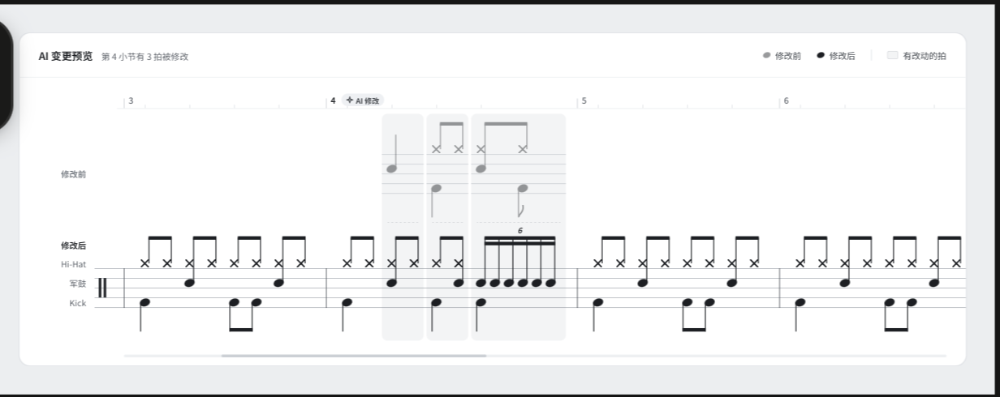

# AI Music Project — Master Notes

> 最後更新：2026-10-27
> 這是專案的唯一正文。原始整理保存在 `sources/`：ChatGPT 版 `chatgpt-summary-2026-10-04.md`、Claude 版 `claude-summary-2026-10-04.md`。
> 狀態標記：**明確決策**＝使用者明確選定／**討論提案**＝提過但沒定案／**待確認**＝有傾向或前提但未拍板，或屬調研資訊需自行驗證／**已被取代**＝曾提出，但後來的決策讓它不再適用／**暫緩**＝使用者決定之後再處理。
> 來源標記：[G#]＝ChatGPT 聊天，[C#]＝Claude 聊天（編號對照見文末「來源」）；[C-2026-10-27]＝使用者在另一個 session 討論、2026-10-27 貼進來的結論；[確認 10-04]＝使用者在 2026-10-04 合併兩份筆記時親自確認。

## 摘要

給鼓手用的轉譜和編輯工具：**上傳音訊 → 自動轉成鼓譜 → 在 Mac 原生 App 裡修正**，並且可以用說話（或文字）請 AI 改譜。網頁版只能瀏覽樂譜，不能編輯。先做鼓譜，之後擴充到吉他、鋼琴等其他樂器，所以編輯器和資料模型從一開始就要考慮多樂器。

目前確定的技術選擇有三項：

- 轉譜引擎用 **Klangio API**。[確認 10-04]
- 後端用 **Cloudflare serverless**，語言用 TypeScript；上傳的音訊和 Klangio 的轉譜結果都暫存在 R2（音訊 TTL 1 天、轉譜結果 TTL 14 天），轉譜結果讓 App 下載，存進使用者本機的 git repo，GitHub 是選用的備份。[確認 10-04][確認 10-11][確認 10-22]
- 帳號和登入用 **Supabase Auth**（Google 或 Apple 登入；註冊的最後一步可以輸入兌換碼，兌換短期的免費會員資格），帳號相關資料放在 Supabase 的 Postgres。[確認 10-27]

商業模式是 **open-core**：樂譜模型、MIDI／MusicXML、Patch、Diff 和本地編輯器開源；AI、雲端、同步、協作和 AI 轉譜收費，轉譜沒有免費額度。樂譜存在**使用者本機的 git repo** 做版本控制（App 內建精簡的 git，不用另外安裝），Mac App 裡有一個按鈕可以直接存檔並 commit。GitHub 改成選用；推上 GitHub 的譜，把網址裡的 github.com 換成我們的網域，就會在網頁檢視器裡看到。[確認 10-04][確認 10-22]

架構定為「一份 TypeScript 核心＋Mac／Windows 的 WebView 外殼」，排版引擎用 **Verovio**（搭配逐行快取）；資料庫定用 Supabase [確認 10-27]；STT、LLM 供應商，以及 Jev 是否採用，都還沒定案。

下一個里程碑是給真實使用者的 **beta**，第一批客群是錄自己練習的鼓手和鼓老師：上傳錄音、轉譜、手動修正、存檔，加上書籤和練習模式（只做 Mac 版）。AI 改譜放到 beta 之後。[確認 10-22] beta 採邀請制（每人一組兌換碼，兌換短期的免費會員資格，內含每月 20 首轉譜；10 人，Klangio 費用由你付），Mac App 用公證過的 DMG 從自己的網站發行；開始收費後 App Store 和網站兩邊一起賣。[確認 10-27]

競品調查（2026-10-06）見 `research/competitors-2026-10.md`：近五年沒有新的寫譜軟體擠進主流；MuseScore 已推出免費的圖片轉譜和音訊轉譜（音訊目前只有鋼琴和木吉他）；Klangio 的鼓譜轉譜已透過 Muse Group 的 MuseHub 發行，可以接 MuseScore 編輯。[C12]

```text
上傳音訊 ─► Klangio API 轉譜 ─► 後處理／轉入內部模型 ─► 編輯器（五線譜）
                                                          ▲
使用者文字／語音 ─► Cloudflare Worker（API／orchestration）    │
                    ─► deterministic rules ─► Jev（候選）     │
                    ─► Router ─► Music Agent／LLM            │
                    ─► 結構化 Patch（符合 schema 的小編輯）    │
                    ─► 驗證 ─► 套用 ─► 新版本（beat 級 diff）─┘
```

上圖把兩邊的討論接在一起，畫的是目前的方向。除了上面兩項已確定的選擇，其餘元件都還是提案。

## 1. Product Vision

- **已被取代**　原本定的是「給鼓手用的網頁工具」：上傳音訊 → 自動轉成鼓譜 → 在內建編輯器手動修正。流程不變，但編輯改到 Mac 原生 App 裡做（見下一條）。[C2][確認 10-04]
- **明確決策**　編輯只在 Mac 原生 App（Local Editor）裡做，之後會有 Windows 版；網頁版只能瀏覽樂譜，不能編輯。[確認 10-04]
- **明確決策**　iPhone、iPad 只提供閱讀，不能編輯。[確認 10-05]
- **明確決策**　先做鼓譜，之後擴充到吉他、鋼琴和其他樂器。編輯器和資料模型要先考慮到未來的其他樂器，保留擴充性。[確認 10-04]
- **明確決策**　目標是商業化。[C2]
- **明確決策**　商業模式採 open-core：核心開源，AI 和雲端服務收費。切分見第 10 節。[確認 10-04]
- **明確決策**　用使用者修正後的資料，回頭改善辨識能力（資料飛輪）。[C2]
- **明確決策**　使用者可以用說話（與 AI 對話）的方式修改鼓譜。[C4][C5]
- **討論提案**　產品是「修改既有的譜」，和「輸入描述、生成整首歌」的 AI 音樂生成產品（例如 ElevenLabs Music）是不同的問題。[G5]
- **待確認**　差異化方向：以轉譜 API（Klangio）當引擎，把編輯體驗（聽著選、批次修正、標示不確定的地方）和修正回饋做成賣點。使用者回應「聽起來蠻合理」，但沒有正式定案。[C2]
- **討論提案**　市場定位：「上傳你的錄音，把練習轉成譜」（鼓手練習、老師出教材、樂團記錄自己的編曲）比「一鍵取得任何歌曲的鼓譜」在版權上安全，而且這群客人的付費意願不低。[C2]
- **明確決策**　第一批客群：錄自己練習的鼓手，以及鼓老師（出教材、批改學生的錄音）。[確認 10-22]
- **討論提案**　作品集價值：語音編輯（應用架構）＋資料飛輪（評估）＋Klangio 整合與上線（系統設計），可以串成一個完整的 AI 工程作品。[C7]
- **待確認**　競品調研（需自行驗證）：
  - Klangio Drum2Notes：有 API、線上編輯器，可匯出 MusicXML／MIDI／PDF；App Store 評分約 3.8，有使用者抱怨結果和原曲無關。
  - Paradiddle：三個模型投票，公開的 F1 為 0.86，會標示不確定的擊點讓使用者確認，並拿來當訓練資料；沒看到對外 API；使用者當時找不到它的網站。
  - DrumScript（開源、規則式）、AnthemScore（編輯功能弱）、Drumscrib、DrumConvert、NotaGen。[C2]
- **待確認**　競品更新（2026-10-06，需自行驗證，細節見 `research/competitors-2026-10.md`）：[C12]
  - 主流格局沒變：MuseScore Studio（使用者最多）、Sibelius（付費市場領導者）、Dorico（專業採用成長）；Finale 2024 年停止開發。
  - Muse Group 幾乎涵蓋整條產業鏈（寫譜、樂譜分享、音色、MuseHub 發行、Audacity、Hal Leonard 出版與零售），商業模式就是 open-core。
  - MuseScore 的 AI：NoteVision 圖片轉譜（2025-07，改成免費加付費）；Audio-to-Score 音訊轉譜 beta（2026-08，免費，自家模型，目前只有鋼琴和木吉他，沒提到鼓）。
  - Klangio 的 Transcription Studio 支援鼓，透過 MuseHub 發行，可以匯出到 MuseScore 編輯：「上傳音訊 → 鼓譜轉譜 → 編輯」這條流程已經被組合出來。
  - AI 轉譜新進者：Songscription（2025-06 上線，鋼琴最可靠，自稱 15 萬名使用者）。
  - Muse Group 的調查（2026-04，1,200 位美國音樂人）：78% 願意用 AI 工具，只有 18% 接受 AI 直接生成整首音樂，而且要能編輯。
- **討論提案**　第二個輸入管道「圖片／PDF 轉譜（OMR）」：評估見 `research/image-to-score-omr-2026-10.md`。建議現在不要自建也先不外購；先把 MusicXML 匯入做紮實（本來就要接 Klangio 的輸出），讓使用者能用 Soundslice、Flat、NoteVision 轉好再匯入，並建一份有權利來源的真實鼓譜評測集。理由：八家工具宣稱支援鼓譜但都沒有獨立品質數據；能商用的 OMR API 只有 Flat；通用多模態 LLM 讀譜很弱；需求多半是「想聽、想練」；上傳買來的譜到雲端再推進 GitHub 有著作權摩擦。等評測和使用數據支持，再把外部 OMR 包成付費功能（只做乾淨數位 PDF、單一五線鼓組譜，每份譜請使用者確認一次 legend 對應）。[C12]
- **討論提案**　差異化要放在 Klangio＋MuseScore 這條流程沒有的地方：鼓譜專屬的修正體驗、語音和 AI 改譜、beat 級 diff、使用者自己的 GitHub 版控；定位成和 MuseScore 互補（`score.musicxml` 可以直接用 MuseScore 開），比取代它合理。[C12]
- **待確認**　宣傳影片已經做好（30 秒、1080p），用的是暫定名「打譜」和 slogan「上傳 轉譜 開打」。影片把語音編輯呈現成已經有的功能。[C9]

## 2. UX / User Flow

### 轉譜與修正

- **明確決策**　主流程：上傳音訊（可以是整首歌）→ 自動轉譜 → 進入內建編輯器修正。[C2] 編輯器現在是 Mac 原生 App。[確認 10-04]
- **明確決策**　模型沒把握的地方，提供 2–3 個候選方案，每個附一小段譜（約 2–4 小節）和對應的音訊，讓使用者聽著選。使用者表示「這就是我理想的狀況」。[C2]
- **明確決策**　「聽著選」在 beta 的做法：Klangio 的輸出沒有查到信心分數或候選方案（`research/klangio-api-2026-10.md`），所以 beta 先自己估。拿每一擊在錄音裡的實際時間（未量化 MIDI），對照它在譜上的位置，以前後幾拍為基準算偏差（扣掉速度飄移）；偏差大的擊點用顏色標成「不確定」，門檻實測後再調。「十六分還是三連音」二選一的候選放到下一版。`transcription.json` 要把未量化 MIDI 一起存進去。原本是 Claude 的建議（待確認），使用者照建議採用。[確認 10-27]
- **明確決策**　點選「不確定」的擊點時，循環播放那一擊前後約一拍的原始錄音（可以放慢）。時間直接用那一擊在未量化 MIDI 裡的時間，不受開頭對齊和速度飄移影響。改過或按「確認」就取消標示，確認的狀態存在 `score.json`。[確認 10-27]
- **明確決策**　編輯器以五線譜呈現。[C2]
- **討論提案**　需要人確認的項目和順序：拍號與小節起點 → tempo 倍數（半速／倍速）→ 網格解析度（十六分 vs 三連音）→ 鼓的類別（tom／snare、ride／hi-hat）→ 重音。前面錯了會一路影響後面。[C2] 2026-10-27：其中「tempo 倍數」**已被取代**，改成進編輯器先直接顯示譜，用「半速／倍速」按鈕切換，不在進編輯器前確認（第 3 節）[C-2026-10-27][確認 10-27]；拍號和網格要不要也這樣做，待確認。
- **討論提案**　候選片段挑鼓最密、最穩的段落（通常是副歌），不要用前奏；播放時在小節開頭加提示音或讓畫面閃一下。[C2]
- **討論提案**　拍號預設 4/4。可以手動改拍號、在特定小節插入變拍、拖動小節線，或指定「以這一擊為第一拍」。[C2]
- **討論提案**　編輯器互動：
  - 播放時游標同步移動，可以單小節循環
  - 鍵盤操作：數字鍵對應鼓種、方向鍵移動、空白鍵播放
  - 批次編輯：複製到相似的小節，或一次把某個位置的 tom 全部改成 snare
  - 低信心的擊點用顏色標示
  [C2]
- **明確決策**　beta 的手動編輯：點選擊點；新增、刪除擊點；用數字鍵改鼓種；切換重音和 ghost note；複製貼上小節；改拍號、插入或刪除小節；復原和重做。先不做 flam、drag、連音的細部編輯，以及「把某個位置的 tom 全部改成 snare」這類批次修改。原本是 Claude 的建議（待確認），使用者照清單採用。[確認 10-27]
- **討論提案**　等待時的體驗：
  - 依 pipeline 的階段回報進度
  - 每處理完約 30 秒就先出那一段的譜，讓使用者先開始編輯
  - 先用能量法給一個粗略的擊點預覽
  - 做成任務列表，加上完成通知
  [C2]
- **討論提案**　譜面渲染元件（這些是在「網頁編輯器」的前提下提的；改成 Mac App 編輯之後，技術選型見 `research/frontend-tech-2026-10.md`）：
  - VexFlow：吃自己的資料來畫譜，編輯互動要自己做
  - OpenSheetMusicDisplay：吃 MusicXML，比較美觀，但編輯一樣要自己處理
  - Flat.io：可以嵌入，但要付費
  - 也可以選 Songsterr 那種格線／tab 介面
  [C2]
- **討論提案**　使用者提出：開始前讓使用者把每個鼓各打幾下，錄成音色模板。Claude 建議只在信心低時當輔助校正（用 MFCC／梅爾頻譜比對），而且只適用單獨錄的鼓聲，混音不適用。[C2]

### 書籤與練習模式

- **明確決策**　可以在譜上選一段小節存成書籤；有一個區塊統一瀏覽這些書籤，選一段來練習；預設速度是歌曲的速度，並提供節拍器。（使用者提出）[確認 10-22]
- **明確決策**　練習模式先只做 Mac 版。[確認 10-22]
- **明確決策**　練習時可以播三種聲音：原始錄音（速度由使用者調）、鼓譜的音符、節拍器。[確認 10-22]
- **明確決策**　書籤和練習模式放進 beta，範圍：選一段小節存成書籤（可以命名）→ 書籤清單 → 點一個就循環播放那一段，開始前有一小節預備拍；速度預設為歌曲速度（取書籤第一小節的速度），可以調整。先不做每輪自動加速，以及節拍器的細項設定（重音、細分拍）。[確認 10-22]
- **明確決策**　書籤存在同一首歌資料夾裡的 `practice.json`：跟著 repo 走，老師可以把書籤連同譜一起給學生，也不會弄亂譜的 diff。[確認 10-22]
- **討論提案**　書籤用小節 ID 記錄，不用小節號碼，這樣前面插入或刪除小節時，書籤還是指向同一段。（Claude 建議）
- **明確決策**　節拍器和游標跟著譜上的 BPM 走。[確認 10-22]
- **明確決策**　速度和音量：一個速度控制同時套用到三種聲音，用百分比表示（50%–120%），旁邊顯示換算出來的 BPM，預設 100%。三種聲音各有開關和音量；預設只開原始錄音，找不到本機音檔時改成預設開鼓譜音符。[確認 10-22]
- **已被取代**　錄音和譜怎麼同步播放：真人錄音的速度會飄，譜用固定的 BPM，直接一起播會越走越分開。Claude 建議：
  - 把錄音對齊到譜的拍子上：播放前把拍與拍之間的錄音稍微拉長或壓短，讓每一拍落在譜的拍子上，拍子內部的手感保留。
  - 每一拍在錄音裡的時間，用同一次 Klangio 轉譜的未量化 MIDI 和量化 MIDI 一一對應算出來，不另外花 beat-tracking 的額度；所以 `transcription.json` 要把未量化的時間一起存進去。
  - 新插入的小節在錄音裡沒有對應，播到那裡錄音靜音；另外提供「錄音提前／延後」的微調滑桿。
  
  → 被下一條「beta 不拉伸錄音，只在開頭手動對齊一次」取代。[確認 10-27] 逐拍對齊的做法留給之後處理速度飄移時參考。
- **明確決策**　beta 不拉伸錄音，錄音照原本的速度播（再套練習的整體速度），只讓使用者在開頭手動對齊一次：在錄音的波形上，把「第 1 拍」的標記拖到鼓聲開始的地方；標記一開始放在錄音最開頭（0 秒）。錄音速度飄移、前面對齊後面卻對不上的情況，beta 先不考慮。[確認 10-27]
- **討論提案**　開頭對齊的細節（Claude 建議）：[C13]
  - 每首歌對齊一次，偏移存在 `practice.json`，編輯器和練習模式共用。
  - 書籤從第 N 小節開始時，錄音的起點＝偏移＋譜上前 N−1 小節的時間（依譜上的 BPM 算）。插入或刪除小節後照譜重算，所以補上 Klangio 漏掉的小節，後面反而會對回來。
  - 波形元件和上傳前「選一段 5 分鐘」共用（第 5 節）。
- **暫緩**　錄音速度飄移、後段對不上時怎麼處理：使用者決定 beta 先不處理。[確認 10-27] 之後要處理時，可以參考上面已被取代的逐拍對齊，或 Klangio 的 beat-tracking 端點。Claude 對 beat-tracking 的說明：[C13]
  - 它分析錄音，找出每一拍落在錄音的第幾秒；Klangio 的 `POST /beat-tracking` 回傳 beat、downbeat、BPM 和拍號，每次扣 1 次額度。
  - 一般用來讓節拍器、游標跟著真人演奏的速度走（例如 Logic 的 Smart Tempo、Ableton 的 warp），或把錄音拉伸成固定速度，也可以用來推斷拍號、半速或倍速。
  - beta 不用它：每首會多扣一次額度；它和轉譜是兩次各自的分析，拍點不一定對得上轉譜切出的小節；同一次轉譜的未量化和量化 MIDI 已經包含差不多的資訊。

### AI 修改的流程

- **討論提案**　使用者用文字或語音描述需求 → 系統判斷意圖 → 需求模糊就先反問，清楚就進入對應的 Agent 或流程 → 產生結構化修改 → 使用者預覽、接受後套用，存成新版本。[G2]

## 3. MVP Scope

- **已被取代**　使用者還沒有明確界定 MVP 範圍。[C2][G1] → 被下一條 beta 範圍的決策取代。[確認 10-22]
- **明確決策**　下一個里程碑是給真實使用者的 **beta**：上傳自己的錄音、Klangio 轉譜、手動修正、存檔（本機 git，GitHub 選用，見第 9 節），加上書籤和練習模式（第 2 節）。AI 改譜（文字、語音）放到 beta 之後。[確認 10-22]
- **明確決策**　beta 範圍的補充：手動編輯照第 2 節的清單；PDF 只做「匯出到本機」，網頁檢視器和「發佈」放到 beta 之後；「備份到 GitHub」放進 beta（第 9 節）。[確認 10-27]
- **明確決策**　進編輯器時先直接顯示譜，前端提供「半速／倍速」切換按鈕，不在進編輯器前強制確認 tempo。[C-2026-10-27][確認 10-27]
- **討論提案**　切換不重跑 Klangio API，保留 MIDI 原始時間，切換時只重新量化與切小節。[C-2026-10-27]
- **討論提案**　每次切換記錄為量化類錯誤（例：Klangio 判 70 BPM → 使用者改 140 BPM），用來分析哪些樂風或 BPM 範圍易錯（記錄方式見第 12 節）。[C-2026-10-27]
- **待確認**　拍號與網格（十六分／三連音）是否也改成「先顯示、有錯再切換」模式。[C-2026-10-27]
- **討論提案**　快速做出 MVP 可以靠 Klangio API（現在已確定使用）。[C8]
- **討論提案**　先做出意圖分類和路由，之後再逐步加入 reranker 和 Patch system。[G2]
- **討論提案**　力道只分 2–3 級（重音／普通），不做連續數值。[C2]
- **討論提案**　Claude 排過一份 16 週的時程，和課程綁在一起：
  - W1：串接 Klangio API
  - W2：定義鼓譜操作工具的 schema
  - W3：準備 100 句口語指令的測試集
  - W4：量測指令解析的準確率
  - W5：接上 STT，完成「說話 → 指令 → 改譜」
  - 第二階段（10/26–11/22）：做出語音編輯 MVP（**已被取代**：下一個里程碑改成 beta，AI 改譜放到之後 [確認 10-22]）
  [C7]
- **討論提案**　自學 Stanford CS329Z: Engineering AI Agents（Fall 2026），資料放在 `study/cs329z/`（課綱摘要、每週閱讀清單、筆記、投影片與論文下載腳本）。和專案直接相關的單元：[C12]
  - W2 structured output、context engineering：語音指令轉成結構化 Patch
  - W3 Tool Use、MCP：鼓譜編輯工具的 schema，以及把編輯功能包成 MCP server（第 6 節，選做）
  - W6 資料飛輪、W7 從 trace 建資料集：使用者修正資料的回饋（第 12 節）
  - W7 eval 基礎、W8 LLM-as-Judge：100 句口語指令測試集與評分（第 7 節）
  可以和上面那份 16 週時程一起排。
- **已被取代**　「先不做 Demucs」「先跑原始模型、不先微調」：這兩點是在自建模型的前提下討論的。改用 Klangio 之後，這些變成日後自建模型時才需要考慮的事。[C2]

## 4. Internal Music Model

- **明確決策**　資料模型和編輯器要能擴充到其他樂器（吉他、鋼琴等），不能把「鼓」寫死在核心結構裡。[確認 10-04]
- **明確決策**　內部的樂譜模型叫 **Canonical Score Model**，屬於開源部分；和它一起開源的還有 MIDI、MusicXML 的轉換，以及 Patch、Diff。[確認 10-04]
- **討論提案**　三層資料模型（Canonical Score Model 的結構候選）：[C2]
  1. 原始偵測：時間點、鼓的類別、信心分數。永遠不修改。
  2. 量化後的譜：第幾小節第幾拍、音符長度。可以重算。
  3. 使用者的編輯操作紀錄：刪除擊點、tom 改 snare、新增擊點等。不覆蓋中間那層。
- **討論提案**　模型的輸出先存成中性的中間格式（時間＋類別＋信心）。量化邏輯改了可以直接重跑，不用重新推論。[C2]
- **討論提案**　編輯器內部用自訂的 JSON 結構，不直接操作 MusicXML 或 MIDI，匯出時才轉換。[C2]
- **討論提案**　匯出格式：MIDI 和 MusicXML 兩種都做（開放標準、有現成的函式庫）。另外，Guitar Pro 格式對鼓手很實用；ABC notation 不適合鼓譜；MuseScore 的格式是封閉的。[C2]
- **待確認**　ChatGPT 那邊的範例把 `score_format` 寫成 `MusicXML`，那只是 payload 範例，不代表選定。[G2]
- **待確認**　要擴充到多樂器，核心模型如何分出「樂器無關」的部分（小節、拍、時值、聲部、版本）和「各樂器專屬」的部分（鼓的類別、吉他的弦／品、鋼琴的音高與踏板）？還沒討論過。

## 5. Audio → Transcription → Score

- **明確決策**　轉譜引擎用 Klangio API。[G1][確認 10-04]
- **明確決策**　離線辨識就好，不做即時串流。[C2]
- **待確認**　Klangio 的整合細節：[C8][G1]
  - 確切的產品和端點
  - 單檔有 300 秒的限制，要先切段（2026-10-27：beta 不切段，改成讓使用者選一段 5 分鐘內的錄音，見下方 [確認 10-27]）
  - 輸出格式：MIDI、MusicXML、PDF、GP5
  - 用 callback 還是輪詢
  - 錯誤處理和費用
  - 鼓譜的實際品質
  - 服務條款是否允許用它的輸出訓練模型
- **待確認**　Klangio API 調研（2026-10-22，細節和來源見 `research/klangio-api-2026-10.md`，需要向 Klangio 確認）：
  - 端點：`POST /transcription?model=drums`，非同步；輪詢 `GET /job/{id}/status`，也可以帶 webhook。
  - 單檔長度：免費方案 15 秒；Startup、Business 300 秒；Enterprise 600 秒。
  - 輸出：MusicXML、未量化 MIDI、量化 MIDI、PDF、GP5、JSON（格式沒有公開）。未量化 MIDI 和原始音訊對齊。另外有 beat-tracking 端點，每次扣 1 次額度。
  - 矛盾：API 規格裡有 `drums`，但 API 的介紹頁寫轉譜只支援 piano、guitar、bass、vocal。
  - 一般使用條款 §12.5：輸出不得用來訓練音樂轉譜 AI。API 的另行條款沒有公開。
  - 信心分數、ghost note、力度：沒有查到。
- **明確決策**　Klangio 實測先用免費方案（每段最多 15 秒、每月 50 次），所以錄音要切成 15 秒的片段來測。要不要寫信向 Klangio 確認 drums 支援和 API 條款，之後再決定。[確認 10-22]
- **討論提案**　實測做法：10 段錄音（不同速度和曲風，要有 fill 和 ghost note），用下方的準確度評估方法評分；大鼓和小鼓的 F 值 ≥ 0.85、hi-hat ≥ 0.7 就照原計劃，沒達到就把產品重心改成修正工具，或重新評估要不要換引擎。（Claude 建議）
- **明確決策**　超過 5 分鐘的錄音（Startup 方案每檔最多 300 秒）：上傳前的畫面顯示整首歌的波形，提醒使用者最多只能上傳 5 分鐘，讓使用者在波形上拖曳選擇要上傳的範圍。一首只算一次請求；不自動切段，避開接縫處小節和拍子對不上的問題。[確認 10-27]
- **討論提案**　用 5–10 首歌（含爵士）做 A/B 測試，比較「原始混音直接丟 Klangio」與「先用 Demucs 分離鼓軌再丟」，以需修正量判斷是否加入分離步驟。預設先丟原始音源。[C-2026-10-27]
- **討論提案**　分離鼓軌即使不用於轉譜，也可放進編輯器供使用者單獨播放鼓聲、對照修譜。[C-2026-10-27]
- **討論提案**　鼓部件分離模型可參考 LarsNet（開源，五部件：大鼓、小鼓、筒鼓、hi-hat、銅鈸；StemGMD 為合成資料，真實錄音效果可能打折）與 DrumSep（社群模型，可在 MVSEP 線上試）。[C-2026-10-27]
- **待確認**　Logic Pro Stem Splitter 在 MVSEP 評測略勝 Demucs htdemucs_ft，但為黑盒子、無法程式呼叫或微調；RoFormer 系列目前分離品質最佳。（需自行驗證）[C-2026-10-27]
- **待確認**　爵士鼓難點包括 ride／hi-hat 高頻易混、鼓刷易被當雜訊、訓練資料以流行搖滾為主。[C-2026-10-27]
- **待確認**　提醒：Klangio 單檔上限 300 秒，整首歌需先切段。[C-2026-10-27] Claude 註記：這和上方「beta 不切段、讓使用者選一段 5 分鐘」的決策不一致，可能是指 A/B 測試用整首歌的情況；另外免費方案每段只有 15 秒。要看哪個情境適用。
- **待確認**　供應商風險：Klangio 已和 Muse Group 合作（Transcription Studio 透過 MuseHub 發行，支援鼓，可接 MuseScore 編輯）。轉譜引擎要保留可替換的介面。[C12]
- **討論提案**　如果引擎只輸出 MIDI，需要後處理（量化、推斷拍號、分離聲部），再用 MuseScore CLI 或 Verovio 渲染。[C8]
- **討論提案**　準確度評估：用 precision／recall／F，容錯窗 ±50ms，分鼓種看（hi-hat 通常比較低）。標準答案可以用使用者修正後的資料。[C2]
- **討論提案**　拍號可以用重音的週期來推估，但變拍（例如 progressive metal）自動判斷不可靠，要交給人確認。[C2]
- **討論提案**　語音轉文字（STT，例如 ElevenLabs Scribe）和音樂轉譜是兩件不同的事，要分開處理。[G5]

### 自建模型路線（現在是備案或日後選項）

以下是在「自己跑模型」的前提下討論的。改用 Klangio 之後，這些變成備案，或之後要自建模型時的參考。哪些步驟 Klangio 已經做掉、哪些仍要自己做（例如量化、校正），還沒確認。

- **討論提案**　Pipeline：ffmpeg 統一格式（單聲道、固定取樣率）→（可選）Demucs 分離鼓軌 → 轉譜模型抓擊點和鼓的類別 → 估計 tempo／beat tracking → 動態選網格量化 → 切分小節 → 計算音符長度 → 渲染鼓譜 → 收集使用者修正。已經做了一份 ELI5 的單頁 HTML 圖解。[C1][C2]
- **待確認**　ADTOF：開源的主流基準，分 5 類鼓（大鼓、小鼓、hi-hat、tom、銅鈸），用 CRNN，多標籤可以處理同時擊打。但程式碼是 CC BY-NC-SA 4.0，資料集也限非商業使用，不能直接商用。可行的路線：寫信向作者 Matthias Zehren 談商業授權、依論文自己訓練，或改接商用 API（現在選了 Klangio）。[C2]
- **待確認**　其他鼓轉譜選項（需自行驗證）：
  - DrumScript：規則式，輸出 PDF／MIDI／MusicXML，授權待查
  - DrummerScore：MIT 授權，但只是學士論文的 notebook，沒經過標準評測
  - ADTLib：只分 3 類，比較舊
  - ADTOF-pytorch：授權可能有一樣的問題
  - Enhanced ADT via Drum Stem Source Separation：8 類加力道，研究授權
  - Noise-to-Notes、STAR Drums
  - Moises、Music AI 的鼓譜表現不明；Basic Pitch 不適合鼓
  [C2]
- **待確認**　通用轉譜服務比較（需自行驗證）：
  - Mirelo Audio-to-MIDI Pro API：有官方 Node.js／TypeScript SDK，支援多樂器
  - Transkun：鋼琴專用，MIT 授權，可以轉 ONNX
  - Spotify Basic Pitch：Apache-2.0，有 npm 套件，只輸出 MIDI
  - MuScriptor：權重是 CC BY-NC 4.0，不能商用
  其中鋼琴和多樂器的選項，之後擴充樂器時可以再拿出來看。[C8]
- **討論提案**　Demucs（htdemucs）負責「分離」，ADTOF 負責「辨識」，前後串接。Demucs 很吃資源（用 CPU 跑一首可能要幾分鐘），而且會留下 artifact。編曲厚重時（例如金屬）有幫助，乾淨的編曲（例如爵士三重奏）反而會變差。要不要跑 Demucs，可以用音訊統計特徵分流，也可以兩路都跑、比較信心分數或把結果融合。[C2]
- **討論提案**　量化：假設十六分、三連音、三十二分等網格，以小節或半小節為單位，選誤差最小的那個；網格越細，懲罰越重。真人打鼓的 tempo 會飄，所以需要 beat tracking。[C2]
- **討論提案**　打不準時的校正：
  - 低信心的擊點放寬吸附
  - 用各小節之間重複的 pattern 互相校正
  - 分層處理：先定大鼓／小鼓的骨架，再對 hi-hat
  - 不確定時回頭看音訊的能量曲線找峰值
  [C2]
- **討論提案**　力道（velocity）：ADTOF 不提供。可以從擊點附近的短時能量估計，分頻段處理重疊、用局部視窗正規化；或改用以 E-GMD 訓練的 Onsets and Frames Drums，力道比較準。[C2]

## 6. AI Agent Architecture

### 整體路由（ChatGPT 的討論）

```text
User request
  → deterministic rules（明確、可以寫成規則的指令）
  → Jev Decision Layer（意圖／複雜度／是否需要深度推理）
  → Router
      ├─ Music Agent
      ├─ RAG / search Agent
      ├─ transcription workflow
      └─ general LLM
  → Agent / LLM 產生結構化 Patch
  → Music Engine 驗證並套用
  → 建立 Revision
```

- **討論提案**　Jev 是做決策和路由的那一層，不是主要的生成式 LLM。應用程式自己控制 threshold、fallback、retry 和實際的動作。[G2]
- **討論提案**　簡單、明確的指令直接走 deterministic rules；複雜的交給能力比較強的 Agent 或 LLM；不明確的就反問或 fallback。[G2]
- **討論提案**　API flow 由後端控制，前端不直接呼叫 Jev。用 provider abstraction 包起來，之後可以換掉決策模型。[G2]
- **討論提案**　Jev 意圖的範例：`music_edit`、`music_question`、`transcription`、`search`、`general_chat`（只是範例，不是最終的分類表）。[G2]

### 語音編輯流程（Claude 的討論）

- **討論提案**　三段式流程（使用者自己描述、Claude 確認過）：語音轉文字 → Jev 判斷要做什麼修改（新增／刪除／修改音符、調速度等）→ 把分類結果和原句交給 LLM 抽出參數（小節、拍、音符類型），產生結構化指令 → 自己的程式執行改譜。[C4][C6]
- **討論提案**　類似 Cursor 的設計：模型不重寫整份譜，只輸出符合 schema 的小編輯（action、target range、parameters），允許的動作像是 replace pattern、change tempo、add fill、delete bars。實際的修改由自己的程式執行，模型不直接碰譜。[C5]
- **討論提案**　分兩輪取上下文：第一輪只給選取的小節，加上整首歌的結構大綱（主歌、副歌在哪幾小節）。資訊不夠時，模型回傳一個「要資料」的動作（和編輯動作放在同一個 schema 裡），程式補上指定的小節再跑第二輪。[C5]
- **討論提案**　套用前先驗證（小節存不存在、pattern 支不支援），不符合就拒絕。[C5]
- **討論提案**　信心門檻：看最高分的絕對值，以及第 1、2 名的差距。
  - 分數高但差距小 → 反問使用者二選一
  - 分數普遍偏低 → 告訴使用者聽不懂（超出範圍）
  - 後端回傳「需要澄清」的狀態，附上前兩個候選意圖，前端轉成問句。使用者選完後連同原句送回，跳過分類直接執行。
  [C6]
- **討論提案**　語音編輯本質上是「一句話 → 一個或幾個工具呼叫」，用不到長時間、多步驟的重型 agent 架構。[C7]
- **已被取代**　「在 NestJS 裡把 Jev 當成一個 service 呼叫」：後端已經定為 Cloudflare serverless，改成由 Worker 呼叫。[C4][確認 10-04]

### Jev

- **待確認**　Jev（TypeSafe AI，目前是 early access）只輸出固定形式（選項、分數、是非），不能抽取任意數值，也不能輸出 MusicXML 這類自由格式。官方宣稱比前沿模型快 40–200 倍、便宜 40–400 倍，接之前要自己測過。[C4]
- **討論提案**　Jev 的價值在成本、延遲，以及不會冒出沒定義過的動作。如果指令種類不多，一開始只用 LLM 加上嚴格的 schema 也夠了。[C6]
- **待確認**　兩邊的討論把 Jev 放在不同層：ChatGPT 那邊用它做**最上層的路由**（編輯、問答、轉譜、搜尋、閒聊）；Claude 那邊用它做**編輯指令的分類**（新增、刪除、修改、調速度）。兩者可以並存，也可以只選一層，還沒決定。[G2][C4]

### 工具

- **討論提案**　ChatGPT 那邊舉的工具例子：`read_score()`、`modify_measure()`、`add_note()`、`delete_note()`、`transpose()`、`play_preview()`、`search_music()`、`get_version()`。[G4]
- **討論提案**　Claude 那邊舉的鼓譜工具例子：加音、刪音、改樂器、改力度，例如 `add_hit(measure=3, beat=2, instrument="snare")`。[C7]
- **待確認**　考慮到之後要支援多樂器，工具 schema 要分成「通用」和「各樂器專屬」兩部分，還沒設計。
- **討論提案**　（選做）把鼓譜編輯功能包成 MCP server。[C7]

## 7. Text / Voice Editing

- **明確決策**　要做語音編輯：使用者說話 → 轉文字 → 指令 → 修改鼓譜。[C4][C5]
- **討論提案**　自然語言的文字指令也是入口之一，和語音走同一套意圖判斷與 Agent 流程。這在 ChatGPT 那邊討論過，Claude 那邊沒提到。[G2]
- **討論提案**　錄音時，同時把目前選取的小節、tempo 等當成上下文一起帶上。[C5]
- **待確認**　指令套用的範圍：有選取時以選取範圍為準（使用者提出、Claude 同意）；沒選取，但話裡有講明（「第十二小節」「最後四小節」）就照講的做。[C6]
- **待確認**　STT 的選擇：
  - 本地 Whisper：不按音訊秒數付費
  - GCP 語音轉文字
  - ElevenLabs Scribe
  原則都是只把轉出來的短句送給模型。後端定為 Cloudflare 之後，要重新評估哪個適合。[C4][C5][G5]
- **討論提案**　準備 100 到幾百句口語指令當測試集，例如：
  - 「把第十小節第四拍補上一個四連音」
  - 「第三小節的小鼓改輕一點」
  - 「把那個 fill 刪掉」
  - 「make bar twelve a half-time shuffle」
  [C4][C5][C7]

## 8. Diff / Versioning

- **明確決策**　AI 的改動以「拍（beat）」為單位，呈現「修改前／修改後」，不逐音符標示新增或刪除，避免六連音這類密集段落看起來很亂。[C10]
- **明確決策**　Patch 和 Diff 屬於開源部分；產生 Patch 的 AI 屬於收費部分。[確認 10-04]
- **討論提案**　beat 級的 mockup 截圖：

  

  畫面是「AI 變更預覽：第 4 小節有 3 拍被修改」，顯示第 3–6 小節，分 Hi-Hat、小鼓、Kick 三列。第 4 小節標了「AI 修改」，第 2–4 拍有淺色底框，上方多一列灰色的「修改前」；其中第 4 拍改成小鼓六連音。右上角圖例：修改前（灰）、修改後（黑）、有改動的拍（淺底）。截圖裡沒有「接受／還原這一拍」的按鈕。[確認 10-04]
- **討論提案**　beat 級 mockup 的設計說明：主譜顯示「修改後」，只有被改的那一拍上方多一列淡化的「修改前」。用淡灰藍背景框住同一拍的兩個版本，中間用虛線分隔；密集的拍自動變寬，並按時間對齊。[C10]
- **討論提案**　每個被改的拍都提供「接受／還原這一拍」，讓審閱的單位和呈現的單位一致（Claude 的建議）。[C10]
- **討論提案**　流程是：模型產生結構化 Patch → Music Engine 驗證並套用 → 建立 Revision。另外有 `get_version()` 工具可以查版本。[G2][G4]
- **待確認**　使用者用「同一個 commit」來描述一批 AI 改動，表示改動是以 commit 為單位。這和 ChatGPT 那邊說的 Revision 應該是同一個概念，名稱要統一；commit 的定義和資料結構都還沒討論。[C10][G2]
- **討論提案**　使用者的修正以一筆一筆的「編輯操作」儲存（三層模型的最上層），可以復原，也可以拿來比對模型錯在哪。[C2]
- **討論提案**　語音編輯用可復原的操作來套用並高亮顯示，使用者可以說「不對，復原」。[C5]
- **已被取代**　音符級的 diff 版本（綠色＝新增、半透明紅＝刪除，拍的背景改成中性色並標上 `+2`／`+1 −1`；同位置、同樂器「刪了又加回」的改動合併成「修改」狀態），已經被 beat 級的設計取代。[C10]

## 9. Local-first / GitHub 版控 / 音訊儲存

### 樂譜存放與版控

- **已被取代**　樂譜用 GitHub 做版本控制，存在**使用者自己的 GitHub repo**，所有權屬於使用者。[確認 10-04] → 被下方「樂譜存在本機 git，GitHub 改成選用」取代；所有權仍然屬於使用者。[確認 10-22]
- **明確決策**　把網址裡的 GitHub 網域換成我們的網域，就會打開我們的**網頁檢視器**，看到同一份譜（只能看）。例如 `github.com/使用者/repo/…` 改成 `我們的網域/使用者/repo/…`。頁面上有「用 Mac App 編輯」的按鈕，所以沒裝 App 的人也看得到譜。[確認 10-04] 網頁顯示的是已發佈的 PDF。[確認 10-05] 2026-10-22 補充：GitHub 改成選用後，只有推上 GitHub 的譜才能這樣看。2026-10-27：網頁檢視器和「發佈」放到 beta 之後，beta 只做匯出 PDF。[確認 10-27]
- **明確決策**　本地編輯器（Local Editor）是 **Mac 原生 App**，屬於開源部分。[確認 10-04]
- **已被取代**　使用者在 Mac App 裡自己串接自己的 GitHub；App 裡有一個按鈕，按下去就會存檔、commit，完成版本控制。[確認 10-04] → 被下方的決策取代：按鈕照樣存檔並 commit，但 commit 在本機；串接 GitHub 改成選用。[確認 10-22]
- **明確決策**　樂譜存在使用者本機的 git repo，App 內建精簡的 git，使用者不用另外安裝。GitHub 改成選用，需要備份或分享的人再串。原因：第一批客群（鼓手、鼓老師）多數沒有 GitHub 帳號。[確認 10-22]
- **明確決策**　git 用 isomorphic-git（MIT 授權），放在 TS 核心裡；檔案存取和網路請求都轉交給 Swift（之後 Windows 轉交給 C#），這樣也避開 GitHub 不支援 CORS 的限制。調研見 `research/beta-tech-2026-10.md`。[確認 10-22]
- **討論提案**　只保留產品需要的 git 操作（Claude 列出）：
  - init：第一次開 App 時建立本機曲庫
  - add＋commit：轉譜完成時存成第一版；「存檔」按鈕
  - status：顯示「有還沒存的修改」
  - log：版本歷史
  - 讀出某一版的檔案：看舊版、和舊版比較、資料飛輪。beat 級的 diff 由 TS 核心自己算，不用 git diff
  - 還原到某一版：讀出舊檔再存成新的 commit，不改寫歷史
  - 設定 remote＋push（HTTPS 加 token）、clone、fetch＋fast-forward：只在串 GitHub 時用
  
  拿掉 branch、merge、rebase、stash、tag、cherry-pick、reset、blame、submodule、hooks、LFS、SSH、git diff 和設定介面。
- **明確決策**　GitHub 上的版本比本機新、而且兩邊都改過時，不 push；讓使用者選以哪一邊為準，另一邊存成一份備份檔。不做自動合併。[確認 10-22]
- **明確決策**　「備份到 GitHub」放進 beta。[確認 10-27]
- **明確決策**　GitHub 登入照下面的流程做（調研見 `research/beta-tech-2026-10.md`）。原本是 Claude 的建議（待確認），使用者照建議採用；三項還要實測的地方見第 15 節。[確認 10-27]
  - 用 GitHub App，網頁授權加 PKCE。網頁授權換 token 時一定要帶 client secret，所以由 Cloudflare Worker 代為換 token 和續期，secret 留在伺服器上；token 存在 Keychain。
  - App 自動建立私有 repo、完成第一次 push。權限只要 Contents 讀寫和 Repository creation。
  - 使用者要親自做的只有三步：註冊或登入（可以用 Google 或 Apple 帳號）、按 Authorize、按 Install。App 不能代替使用者建立 GitHub 帳號，GitHub 服務條款禁止自動註冊。
  - 不用 device flow：GitHub 的 best practices 指出它有釣魚風險，桌面 App 建議改用網頁授權加 PKCE。
- **討論提案**　我們自己的帳號（Google／Apple 登入，第 11 節）和 GitHub 的授權是兩件事：前者用來轉譜、兌換碼和付費，後者只用來備份和分享譜。（Claude 註記）[C13]

### repo 裡的檔案

- **明確決策**　每首曲子的檔案：[確認 10-04]

  ```text
  songs/<曲名>/
  ├── score.json          ← Canonical Score Model，唯一會被編輯的檔
  ├── score.musicxml      ← 每次 commit 時從 score.json 自動產生（給 MuseScore 等軟體開）
  └── transcription.json  ← Klangio 的原始轉譜結果，只寫一次，永不修改
  ```

  - MIDI 不進 repo，要用時再匯出。
  - 音訊不進 repo（存放方式另外決定，見下方「音訊」）。
  - 只有 `score.json` 會被編輯。MusicXML 是匯出的快照，所以不會發生「兩個檔不一致、哪個才對」的問題。
  - 以 JSON 為主，是因為 MusicXML 放不下信心分數、AI 修改紀錄，以及之後多樂器的擴充欄位。
  - 2026-10-22 新增 `practice.json`：存這首歌的書籤（第 2 節）。[確認 10-22] 書籤不是譜的內容，所以不影響「只有 `score.json` 會被編輯」這條（Claude 註記）。2026-10-27：錄音開頭對齊的偏移也建議存在這裡（第 2 節，Claude 建議）。
- **明確決策**　轉譜完成後，App 直接把 Klangio 的原始結果做成**第一個 commit** 並 push。之後 `transcription.json` 不會再被修改，後續的編輯結果都存成新的 commit。[確認 10-04]
  - 轉譜結果先暫存在 R2，App 從那裡下載後再 commit，見第 11 節。[確認 10-11]
  - 2026-10-22：commit 在本機；有串 GitHub 時才 push。[確認 10-22]

### 音訊

- **討論提案**　音訊處理的三種做法：[C2]
  - (a) 純本地：ADTOF 轉成 ONNX，用 onnxruntime-web 在瀏覽器跑。
  - (b) 暫時上傳，處理完就刪，只留下譜。
  - (c) 音訊只存在瀏覽器的 IndexedDB。

  Claude 建議 (b)。改用 Klangio 後，音訊一定要送出去，所以 (a) 已經不適用。這三種做法和下面的 hash 設計都是以瀏覽器為前提（File API、IndexedDB）；改成 Mac App 後，App 可以直接讀本地檔案，「雲端不留音檔、用 hash 配對本地檔案」的概念仍然可以沿用（Claude 註記）。
- **明確決策**　上傳的音訊暫存在 R2，TTL 1 天；轉譜成功後不主動刪除，等 TTL 到期由 R2 自動刪除（取代上面 (b)「處理完就刪」的做法）。音訊不進使用者的 repo（前面已定）。上傳的細節見第 11 節。[確認 10-11]
- **明確決策**　本地音檔配對用 SHA-256 比對；hash 對不上時（例如使用者轉過檔）只警告、不阻擋，並讓使用者手動選擇音檔。[確認 10-22]
- **明確決策**　上傳前的處理：本機保留原始檔的 SHA-256（用來配對），先取出音訊、轉格式並壓縮再上傳。（使用者提出）[確認 10-27]
- **明確決策**　收 WAV、AIFF、MP3、M4A、FLAC，以及手機錄的影片（MOV、MP4，只取音軌），一律轉成 M4A（AAC 256 kbps）：5 分鐘約 10 MB，macOS 內建就能轉。OGG 先不收（macOS 內建讀不了）。Klangio API 收不收 M4A 要用免費方案實測，不收就改成 WAV。[確認 10-27]
- **明確決策**　使用者選擇深入 (b)，並複述了設計：雲端只存音檔的 hash，和譜綁在一起；使用者下次在本地選同一個檔案時，用 hash 配對，再用 File API 在本地播放，不用重新上傳。原本沒有明確宣告定案（**待確認**），已由上一條決策確認。[C2][確認 10-22]
- **討論提案**　hash 的細節：[C2]
  - 整檔算 SHA-256 要用 Web Worker，或只算前幾 MB 加上檔案大小。
  - 使用者轉過檔（MP3 ↔ WAV）導致 hash 不符時，只警告、不阻擋。（已由上方的明確決策確認 [確認 10-22]）
  - 對外要講清楚是「只上傳一次」，不是完全不上傳。
- **已被取代**　用音訊指紋取代 SHA-256，以容忍轉檔（Claude 提出）。→ 被上方「本地音檔配對用 SHA-256，對不上只警告並讓使用者手動選檔」的決策取代，不採用。[確認 10-22]
- **明確決策**　使用者勾選同意後，音訊另外保留下來供將來訓練，不受 1 天 TTL 影響；沒有同意的照原本 1 天後刪除。細節見第 12 節。[確認 10-22]
- **討論提案**　使用者提出：讓使用者把音訊放在自己的雲端空間（例如 Google Drive、Dropbox），服務只在處理時暫時讀取。[C2]
- **已被取代**　音訊要不要放進使用者的 GitHub repo？音檔很大，直接放進 git 不適合（可能要用 Git LFS，或音訊另外存放、repo 裡只放 hash）。還沒討論。→ 被「音訊不進 repo」取代（本節檔案結構的明確決策 [確認 10-04]，2026-10-11 再次確認，包括不用 Git LFS）。[確認 10-11]
- **待確認**　離線編輯、同步衝突怎麼處理，還沒設計。[C2][G1] 2026-10-22 補充：曲庫改存在本機，所以離線就能編輯；和 GitHub 兩邊都改過時由使用者選邊（見上方）。付費 Sync 的衝突處理仍未設計。

## 10. Open-core / Free vs Paid

- **明確決策**　採 open-core，切分如下：[確認 10-04]

  ```text
  Open Source（免費）            Commercial（收費）
  ├── Canonical Score Model      ├── AI
  ├── MIDI                       ├── Cloud
  ├── MusicXML                   ├── Sync
  ├── Patch                      ├── Collaboration
  ├── Diff                       └── AI Transcription
  └── Local Editor
  ```

- **明確決策**　AI 轉譜全部付費，沒有免費額度。免費的只有開源部分。[確認 10-04]
- **待確認**　競品壓力：MuseScore 的音訊轉譜和圖片轉譜都有免費方案；如果之後免費支援鼓，「AI 轉譜全部付費」會直接面對免費對手。Claude 的建議是把收費價值放在修正體驗和 AI 改譜，而不是轉譜本身。決策沒有改，只是記下風險。[C12]
- **明確決策**　付費的 Sync：由我們自動幫使用者同步，使用者不用自己串接外部的 GitHub，隱私性也比較好。**先不做**，第一階段以 GitHub 為主。[確認 10-04]
- **暫緩**　開源部分用哪一種授權，之後再決定。[確認 10-04]
- **已被取代**　使用者原本提出分方案：基本版走單一路徑；進階版有 Demucs、沒有 Demucs 兩路都跑，再比對結果。Claude 建議基本版免費、進階版（兩路融合）收費，兩路結果不一致的地方在編輯器標示「請確認」。這個分法已經被「轉譜全部付費」取代。不過「兩路結果不一致就標示請確認」的做法，日後自建模型時仍可參考。[C2][確認 10-04]
- **待確認**　競品定價（需自行驗證）：Paradiddle 第一首免費，之後付費（沒查到價格）；Drumscrib 每首約 US$1.8–3.6；DrumConvert 訂閱每月約 US$9–29。[C2]
- **待確認**　成本面（需自行驗證）：Klangio API 分級約每月 $0–$499 以上，成本隨用量增加；Mirelo 約每分鐘 €0.11–0.14。[C2][C8] 2026-10-22 查證（`research/klangio-api-2026-10.md`）：Klangio 按請求次數計費。Basic $0（50 次，每檔 15 秒）；Startup $99／月（500 次，超額每次 $0.20）；Business $499／月（3,000 次，超額 $0.17）；Enterprise 洽詢（10,000 次，超額 $0.10）。
- **明確決策**　beta 期間的轉譜費用：beta 採邀請制，Klangio 費用由你付，10 人、每人每月 20 首（這個額度包含在兌換碼送的短期免費會員資格裡，見第 11 節）；這是只限 beta 的例外，「AI 轉譜全部付費」不變。免費方案每檔只能 15 秒，beta 要升級到 Startup 方案（$99／月含 500 次，每檔 300 秒），升級前最好先確認 API 正式支援 drums。每首一次請求的話約用 200 次，還有餘裕（超過 5 分鐘的錄音讓使用者選一段，見第 5 節；一次要多種輸出可能多算額度）。原本是 Claude 的建議（待確認），使用者照建議採用。[確認 10-27]
- **明確決策**　發行和收款：beta 用公證過的 DMG，從自己的網站發給受邀的人。開始收費後兩邊一起賣：Mac App Store 版用 Apple 內購（價格較高），網站版用自己的金流（較便宜），兩邊買的都記在同一個帳號（第 11 節「帳號與登入」）。（使用者提出）[確認 10-27]
- **待確認**　Apple 的規定（2026-10 查證，需自行驗證，細節見 `research/login-payments-2026-10.md`）：[C13]
  - 台灣和大多數地區：App 和商店頁不能放導向其他付款方式的按鈕、連結或文字，也不能說網站比較便宜（準則 3.1.1(a)）；在 App 以外（網站、email、社群）告訴使用者可以（3.1.3）。
  - 美國區：可以放外部購買連結，不用申請；Apple 能不能對這些購買抽成，法院還在審（2026-08 Apple 提出 15%，小型開發者 5%）。
  - 網站買的可以在 App Store 版用，前提是 App 裡也買得到同樣的東西（3.1.3(b)）。
  - App Store 版不能用自己的兌換碼解鎖功能或送點數（3.1.1），要改用 Apple 的 offer code，或讓使用者到網站兌換。
  - App Store 內購抽 15–30%，Small Business Program 15%。從自己網站發行的版本不經過 Apple，不抽成。
- **討論提案**　商業化的版權防護：[C2][C7]
  - 上傳前勾選聲明「有權處理這個檔案」（必要，但不夠）。
  - 在多數法域，轉錄別人歌曲的鼓譜可能算衍生作品，收費前建議先問律師。
  - Klangio 的服務條款可能限制用它的輸出訓練競爭模型。（2026-10-22 查到：一般使用條款 §12.5 明文禁止用輸出訓練轉譜 AI，見第 12 節。）

## 11. Backend / Frontend / Infra

### 後端

- **明確決策**　後端用 Cloudflare serverless。[確認 10-04]
- **明確決策**　後端語言用 TypeScript。[確認 10-11]
- **討論提案**　Rust 評估（Claude 建議）：
  - Cloudflare Worker 和 TS 核心維持 TypeScript，不改寫成 workers-rs。理由：Worker 大部分時間花在等待 Klangio、LLM、R2 等網路 I/O，用不到 Rust 的效能；TS 核心要同時跑在 WebView 和 Worker 裡，改成 Wasm 會多出 JS↔Wasm 的轉換成本；而且 spike 已經達到「500 小節改一拍 < 100 ms」。
  - Rust 只保留給日後 CPU 密集的純運算（例如擊點和錄音的 onset 對齊），編成 Wasm 引入。如果之後自建模型，可以把擊點比對、錯誤分類做成共用的 crate（wasm-bindgen 給 TS、PyO3 給 Python）。
- **明確決策**　Klangio 的轉譜結果先存到 R2，產生一個 URL 讓 Mac App 下載；TTL 是 14 天，下載完就刪除。永久儲存靠使用者自己的 GitHub repo（App 下載後做成第一個 commit，見第 9 節）。[確認 10-11] 2026-10-22：永久儲存改成使用者本機的 git repo，GitHub 選用。[確認 10-22]
- **討論提案**　轉譜結果「下載完就刪除」的時機改成 App 回報 commit 和 push 成功之後才刪，14 天的 TTL 當作保底。如果只是下載成功、但 commit 或 push 失敗，R2 上的檔案已經刪掉就救不回來，使用者得重新付費轉譜。[C12]
- **明確決策**　上傳的音訊也放在 R2，TTL 1 天；轉譜成功後不主動刪除，等 TTL 到期由 R2 自動刪除。[確認 10-11]
- **明確決策**　Cloud、Sync、Collaboration 屬於收費部分（見第 10 節）。[確認 10-04]
- **討論提案**　Cloudflare Worker 當 API 和 orchestration 的入口（範例 endpoint：`POST /chat`），負責呼叫 deterministic rules、Jev、router 和後續的 Agent 或 API。[G2]
- **待確認**　具體要用哪些 Cloudflare 服務（資料庫、物件儲存、佇列、即時狀態），還沒決定。[G2] 2026-10-11 補充：物件儲存確定用 R2（音訊 TTL 1 天、轉譜結果 TTL 14 天，見上方），資料庫、佇列、即時狀態仍未決定。[確認 10-11] 2026-10-27 補充：資料庫定用 Supabase（見下一條和「帳號與登入」）[確認 10-27]；佇列、即時狀態仍未決定。
- **已被取代**　資料庫：先前傾向 Supabase（Postgres + Auth + Storage 一站式；使用者回過「Yeah」，但沒同意記成決策），也比較過自架 VPS + Postgres、Neon（branching）、Firebase、PlanetScale、MongoDB。後端定為 Cloudflare 之後，要重新評估要用 Cloudflare 自己的服務，還是外接 Supabase。[C3] → 被下方「帳號系統用 Supabase Auth，帳號相關資料放在 Supabase 的 Postgres」取代。[確認 10-27]
- **討論提案**　非同步處理：用佇列，前端用輪詢或 WebSocket 拿進度。[C2]
- **討論提案**　上傳：用 presigned URL 直接傳到物件儲存；用儲存桶的生命週期規則（例如 24 小時）自動刪除，處理成功時也主動刪；介面上標示「音訊已刪除」，當作讓使用者安心的訊號。[C2] 2026-10-11：儲存位置定為 R2、TTL 定為 1 天，和這裡「例如 24 小時」一致；「處理成功時也主動刪」**已被取代**，改成不主動刪、等 TTL 到期由 R2 自動刪除 [確認 10-11]；presigned URL、介面標示仍是討論提案。
- **已被取代**　後端定為 Cloudflare 之後，以下提案不再採用：
  - Python 推論服務 + NestJS gateway [C2]
  - GCP Cloud Run GPU workers + Pub/Sub [C8]
  - 用 Vercel 或 Render 部署後端 [C3]
- **待確認**　GPU 服務（RunPod、Modal、Replicate；Replicate 有託管的 Demucs）以及 ADTOF 可以用 CPU 跑，這些只有在之後自建模型時才用得到。[C2]

### 帳號與登入

- **明確決策**　登入用 Google 或 Apple 帳號。這套登入和兌換碼之後的正式版沿用，beta 的邀請也用它。（使用者提出）[確認 10-27]
- **明確決策**　兌換碼的位置和流程：放在註冊帳號流程的最後一步，讓使用者輸入兌換碼；同時提醒使用者現在不輸入也沒關係，註冊完登入之後，App 的設定裡也有欄位可以再輸入。（使用者提出）[確認 10-27]
- **明確決策**　兌換碼兌換的是會員計畫：一段短期的免費會員資格，會員資格裡含免費的轉譜額度。送的是會員資格，不是單次的轉譜次數。（使用者提出）[確認 10-27]
- **已被取代**　beta 用「Email 登入連結」認人（討論中一度選擇）。→ 被上一條「Google 或 Apple 登入＋兌換碼」取代，因為登入要和正式版沿用。[確認 10-27]
- **明確決策**　帳號系統用 Supabase Auth：Google、Apple 登入都內建，token 續期、刪帳號不用自己寫，有 Swift 和 JS 的 SDK。Worker 用公開金鑰驗證登入 token。帳號、會員資格、兌換碼、用量、購買紀錄放在 Supabase 的 Postgres，所以資料庫也定為 Supabase。[確認 10-27]
- **明確決策**　用到雲端功能才要求登入：開 App、編輯本機的譜、練習模式都不用登入（Local Editor 是開源、免費的部分）；按「上傳轉譜」時才跳出登入（或註冊）畫面。[確認 10-27]
- **明確決策**　beta 的兌換碼每人一組、只能用一次：你替 10 位測試者各產生一組，兌換後得到 beta 的短期免費會員資格，內含每月 20 首轉譜額度。碼外流也只會被一個人用掉，而且看得出是誰兌換的。[確認 10-27]
- **討論提案**　每月用量由 Worker 依帳號記錄，超過會員資格的額度（beta 是 20 首）就擋。（Claude 建議）[C13]
- **待確認**　短期免費會員資格多長、到期後怎麼辦；會員資格除了轉譜額度還包含什麼；正式的會員方案內容和價格（第 15 節）。
- **待確認**　Sign in with Apple 的限制（調研見 `research/login-payments-2026-10.md`）：Apple 的功能對照表裡，原生的 Sign in with Apple 只開放給上架 App Store 的 Mac App，從自己網站發行的 DMG（Developer ID）版不能用。DMG 版要改走 Apple 的網頁登入流程（Services ID）：使用者看到的一樣是 Apple 的登入視窗，但一定要有後端，而且 client secret 每 6 個月要重新產生。App Store 版可以用原生登入。[C13]
- **待確認**　Supabase 免費方案的專案 7 天很少活動就會暫停（付費方案不會）；beta 只有 10 人，可能要升級付費方案。（來自搜尋結果，Supabase 官網在這個環境連不上，沒有直接查證）[C13]

### 前端

- **明確決策**　編輯器：Mac 原生 App（現在）、Windows（之後），開源。閱讀：網頁、iPhone、iPad，只能看。[確認 10-04][確認 10-05]
- **明確決策**　架構：**一份 TypeScript 核心**（樂譜模型、Patch、Diff、引擎轉接、diff 預覽），Mac 和 Windows 用很薄的 WebView 外殼（Mac：Swift＋WKWebView；Windows：WebView2）。商業邏輯不放在 Swift 或 C# 裡。[確認 10-05]
- **明確決策**　網頁和 iPhone／iPad **只顯示 PDF**，不在這些平台即時排譜，所以排版引擎只跑在 Mac／Windows 編輯器裡。PDF 用編輯器裡同一個引擎產生（Mac：`WKWebView.createPDF`；Windows：WebView2 `PrintToPdfAsync`），所以和編輯器看到的一樣。[確認 10-05]
- **明確決策**　PDF 只在使用者按「發佈」或「匯出」時才產生，不是每次 commit 都產生，讓 repo 保持乾淨。[確認 10-05]
- **已被取代**　研究階段原本傾向 alphaTab（重排快、內建播放、TS 原始碼、MPL 授權），備案 Verovio。研究見 `research/frontend-tech-2026-10.md`、`research/verovio-vs-alphatab-2026-10.md`。
- **明確決策**　**排版引擎用 Verovio，搭配逐行快取。**[確認 10-05] 依據是 spike 的結果（`research/spike-results-2026-10.md`）：
  - Verovio 不用改原始碼就是一般鼓譜寫法。alphaTab 有三個問題要改原始碼才能修：腳的休止符飄在上方、重音畫在下方、open hi-hat 的「o」畫不出來。
  - 搭配逐行快取，兩者都達到「500 小節改一拍 < 100 ms」（p95：alphaTab 34 ms、Verovio 84 ms）。
  - Verovio 的逐行渲染和整份渲染一致；alphaTab 不一致。
  - 我們的 ID 會直接出現在 Verovio 的 SVG 裡。
  - alphaTab 不採用，研究和 spike 的紀錄保留供參考。
- **明確決策**　先做約兩週的 spike，用兩個引擎各寫最小的 Mac 原型（Swift＋WKWebView）比較。[確認 10-05] 關卡：
  - G1：sticking、open hi-hat 的呈現（使用者判斷）
  - G2：500 小節改一拍，在 WKWebView 裡到畫面更新 < 100 ms
  - G3：做得出 mockup 的 diff 預覽
  - G4：點選、播放游標、AI patch 都對得到我們的 ID
  - G5：A4 PDF 的品質（使用者判斷）
  - G6：逐行快取（換行固定、只重畫改到的那一行，跨行元素不出錯）
- **討論提案**　**換行固定**：第一次轉譜時自動決定換行（預設每行 4 小節、段落開新行），之後鎖住；某一行太擠時標示或只從那一行往後局部重排。換行存在 `score.json`。這符合打譜軟體鎖定換行（casting off）的做法，以及鼓譜每行 4 小節、樂句上下對齊的慣例。視窗大小改變時縮放，不重排。（Claude 建議）
- **討論提案**　**類似 React Virtual DOM 的重繪**：以「一行譜」為快取單位（同一行的小節會互相影響寬度，所以不能以小節為單位）。用小節 ID 對齊、用 hash 判斷是否改動，只重排、重畫有改動的那一行，其他行用快取；快取 key＝這一行小節的 hash＋排版設定＋引擎版本。（Claude 建議）
- **明確決策**　練習模式的播放在 Swift 原生做：三種聲音（原始錄音、鼓譜音符、節拍器）都在 AVAudioEngine 裡播，共用同一個時鐘；變速用 `AVAudioUnitTimePitch`，鼓的音色用 `AVAudioUnitSampler`。TS 核心只算出「什麼時間點播什麼」，交給 Swift。之後做 Windows 時，播放這塊要用 C# 重寫。[確認 10-22] 播放屬於系統功能，不違反「商業邏輯不放在 Swift」（Claude 註記）。
- **明確決策**　鼓譜音符的音色用 Big Rusty Drums（CC0，不用署名）。調研見 `research/beta-tech-2026-10.md`。[確認 10-22]
- **討論提案**　只取 CSM 會用到的鼓件，每種保留約 4 層力度，最小的一層當 ghost note，讓 App 只多出幾十 MB。Big Rusty 是 SFZ 格式，Apple 的 sampler 不能直接讀，要先轉檔或逐一載入音檔。（Claude 建議）
- **已被取代**　「網頁檢視器即時排譜、可能有播放」：改成只顯示 PDF。[確認 10-05]
- **已被取代**　ChatGPT 那邊架構圖裡的 React 前端，以及第 2 節以網頁編輯器為前提的渲染元件（VexFlow、OpenSheetMusicDisplay、Flat.io），要依研究結果重新評估。[G2][C2]

### 開發流程

- **討論提案**　CI 用 GitHub Actions。原本搭配 Vercel／Render 在 push 時自動部署，現在部署目標要改成 Cloudflare。[C3]
- **討論提案**　開發時導入 AI agent：用 Claude Code／Cursor 協助開發，CI 裡讓 agent 做 PR review。[C3]
- **明確決策**　beta 的 Mac App 從自己的網站下載，用 Apple 公證過的 DMG 安裝檔。Mac App Store 的沙盒會限制檔案存取（曲庫資料夾、配對本機音檔都要使用者先授權），在 App 裡賣轉譜也要走 Apple 內購，被抽 15–30%。原本是 Claude 的建議（待確認），使用者照建議採用。[確認 10-27] 原本的「要不要上架 App Store，等開始收費再決定」**已被取代**：開始收費後 App Store 和網站兩邊一起賣（第 10 節）[確認 10-27]；要不要上 MuseHub 仍未決定（第 15 節）。
- **明確決策**　DMG 版用 Sparkle 自動更新（MIT 授權，Mac 上不經 App Store 發行的 App 最常用的更新框架）：App 檢查新版、下載、驗證簽章後更新，beta 常發新版時測試者不用自己重新下載。[確認 10-27]
- **討論提案**　App Store 版和 DMG 版的差別（Claude 整理）：App Store 版要開沙盒（曲庫資料夾、本機音檔都要使用者先授權）、Apple 登入用原生的、付款用 StoreKit；DMG 版不用沙盒、Apple 登入走網頁流程、金流用自己的。兩邊都需要 Apple Developer Program（每年 US$99）。[C13]

## 12. AI Feedback → Prompt Iteration

### 辨識的資料飛輪

- **明確決策**　用使用者修正後的資料，回頭改善辨識。[C2]
- **明確決策**　修正資料的來源：比對使用者 repo 裡的第一版（`transcription.json`，第一個 commit）和後續 commit 的編輯結果。[確認 10-04]
- **明確決策**　訓練之後再做，現在先確保將來訓練要用的資料有存下來：使用者勾選同意後，保留這首歌的音訊、譜，以及和 AI 對話改譜的紀錄。[確認 10-22]
- **待確認**　同意之後的細節，使用者還在考慮。Claude 的建議：
  - 音訊：轉譜時本來就傳到 R2 了，同意的話在 1 天的 TTL 到期前複製到另一個不自動刪除的 bucket，不用重新上傳。
  - 譜：曲庫在本機，每次按「存檔」時由 App 送出 `score.json`。
  - AI 對話紀錄：AI 改譜本來就經過 Worker，在伺服器端記錄。
  - 每首歌上傳時各勾一次，預設不勾；可以撤回，撤回後刪掉我們保存的那首歌的所有資料；保存到撤回為止。
- **待確認**　Klangio 一般使用條款 §12.5 禁止用輸出訓練轉譜 AI，API 的另行條款沒有公開（`research/klangio-api-2026-10.md`）。將來要訓練自己的模型前，要先和 Klangio 談豁免，或改用沒有經過 Klangio 的資料。
- **已被取代**　我們的伺服器怎麼讀到使用者的 repo？私有 repo 需要使用者授權讀取權限；使用者同意、隱私條款怎麼寫，也還沒討論。→ 曲庫改存在本機（GitHub 選用），伺服器不一定讀得到；改成使用者同意後保留資料（見上方）。[確認 10-22]
- **討論提案**　記錄的是「差異」，不只是最後的結果（漏抓、誤抓、類別錯）。優先挑模型信心低、但使用者改動大的樣本。[C2]
- **討論提案**　用 Klangio 時，模型沒辦法重新訓練，飛輪改成下面這樣：[C7]
  1. 加一層後處理修正：先用規則處理（ride 誤判成 hi-hat、fill 時值錯、ghost note 漏抓），資料夠多再換成小模型。
  2. 把 Klangio 的輸出和使用者修正後的版本做 diff，得到結構化的錯誤標註（漏抓、多抓、樂器判錯、時間偏移），依曲風、速度、段落統計。
  3. 把修正後的資料當成自己的測試集：用來評估供應商的更新、比較其他服務、依曲風決定路由。
  4. 持續累積資料，保留日後自建模型的選項。
  5. 問 Klangio 有沒有回饋合作的機制。
- **待確認**　微調自有模型（學習率約為原本的 1/10，凍結前段的特徵層、只解凍最後幾層）：只有自建模型才需要。當時的建議是先不要微調，因為很多問題其實出在量化後處理。[C2]

### 修正資料的記錄（Correction Data）

以下是 2026-10-27 從另一個 session 帶進來的結論。和第 4 節的三層資料模型、第 9 節 `score.json`＋git commit 的存法怎麼接，還沒對過（見第 15 節）。

- **討論提案**　記錄三層：[C-2026-10-27]
  1. 原始輸出：時間、鼓種、信心、模型／API 版本，永不修改。
  2. 編輯操作紀錄：每筆操作的類型、目標擊點、改前改後、時間戳。採 event sourcing，最終譜＝原始＋操作重播。
  3. 使用者按「完成」時的最終譜。
- **討論提案**　記錄播放範圍；使用者聽過但沒改的段落視為已確認正確，沒聽過的不算。[C-2026-10-27]
- **討論提案**　錯誤分類：[C-2026-10-27]
  - 量化類：改拍號、插入變拍、拖小節線、「以這一擊為第一拍」、半速倍速切換、把音符拖到不同網格。
  - 辨識類：新增、刪除擊點、改鼓種。
- **討論提案**　寫入時機：(a) 聽候選片段選擇時，記錄模型排第一的選項與使用者實際選擇；(b) 編輯器內每次操作。[C-2026-10-27]（Claude 註記：beta 先不做二選一候選，見第 2 節，所以 (a) 是下一版的事。）
- **討論提案**　Klangio 無法被訓練，資料用途依序是：評測集（比較 API、模型、量化參數）→ 疊在 Klangio 後的修正模型（如 tom／snare 重判分類器）→ 長期訓練自有轉譜模型取代 API。[C-2026-10-27]
- **討論提案**　資料品質：依使用者修改紀錄評估可靠度；多人共編同一首譜時取共識。[C-2026-10-27]
- **討論提案**　授權：服務條款需寫明上傳內容用於改善模型；考慮只存訓練需要的片段或特徵，降低版權風險。[C-2026-10-27]
- **待確認**　長期是否持續用 Klangio 或換自有模型，這會決定資料要存多細。[C-2026-10-27]

### Prompt 和指令解析的迭代

- **討論提案**　改善的閉環：使用者回饋 → 收集失敗案例，並對應到 prompt 版本和 trace → 人工或 AI 分類問題 → 建立實驗版的 prompt → 在固定的資料集上跑 evaluation → 確認有改善才發布。[G3]
- **討論提案**　不要因為一個負評就自動修改正式的 prompt。[G3]
- **討論提案**　語音指令的評估：建立口語指令測試集，每次改 prompt 或換模型就自動評分，用數字確認準確率有沒有進步。[C7]
- **待確認**　Langfuse 可以整合 tracing、prompt 管理、使用者回饋、資料集和 evaluation，但只是舉例，還沒決定採用。[G3]

## 13. Decision Log

| 日期 | 決策 | 來源 |
|---|---|---|
| 2026-09-07 | 產品主流程：上傳音訊 → 自動轉譜 → 內建編輯器修正 | [C2] |
| 2026-09-07 | 離線辨識，不做即時串流 | [C2] |
| 2026-09-07 | 目標是商業化 | [C2] |
| 2026-09-07 | 用使用者修正後的資料回頭改善辨識 | [C2] |
| 2026-09-07 | 沒把握的地方提供候選＋音訊＋譜讓人選 | [C2] |
| 2026-09-07 | 編輯器以五線譜呈現 | [C2] |
| 2026-09-17 | 加入語音（對話）編輯 | [C4][C5] |
| 2026-09-29 | AI 的改動以 beat 級「修改前／修改後」呈現 | [C10] |
| 2026-10-04 | 轉譜引擎用 Klangio API | [G1][確認 10-04] |
| 2026-10-04 | 先做鼓譜，之後擴充到吉他、鋼琴等；編輯器和資料模型要能擴充 | [確認 10-04] |
| 2026-10-04 | 後端用 Cloudflare serverless；前端還沒決定 | [確認 10-04] |
| 2026-10-04 | 商業模式採 open-core：Canonical Score Model、MIDI、MusicXML、Patch、Diff、Local Editor 開源；AI、Cloud、Sync、Collaboration、AI Transcription 收費 | [確認 10-04] |
| 2026-10-04 | AI 轉譜全部付費，沒有免費額度 | [確認 10-04] |
| 2026-10-04 | 樂譜存在使用者自己的 GitHub repo 做版控；把網址裡的 GitHub 網域換成我們的網域，就會打開網頁檢視器（只能看，有「用 Mac App 編輯」按鈕） | [確認 10-04] |
| 2026-10-04 | 編輯只在 Mac 原生 App（Local Editor，開源）裡做；網頁版只能瀏覽 | [確認 10-04] |
| 2026-10-04 | 使用者在 Mac App 裡串接自己的 GitHub，按一個按鈕就存檔並 commit | [確認 10-04] |
| 2026-10-04 | repo 檔案：`score.json` 為主、`score.musicxml` 在 commit 時自動產生、`transcription.json` 存 Klangio 原始結果；MIDI 和音訊不進 repo | [確認 10-04] |
| 2026-10-04 | 轉譜完成後，Klangio 原始結果直接做成第一個 commit 並 push，之後永不修改 | [確認 10-04] |
| 2026-10-04 | 資料飛輪的修正資料：比對 repo 裡的第一版和後續 commit | [確認 10-04] |
| 2026-10-04 | 付費 Sync（自動同步、不用串 GitHub）之後再做，先以 GitHub 為主 | [確認 10-04] |
| 2026-10-05 | iPhone／iPad 只閱讀；網頁和 iPhone／iPad 只顯示 PDF，PDF 在發佈或匯出時才產生 | [確認 10-05] |
| 2026-10-05 | 架構：一份 TS 核心＋Mac／Windows 的 WebView 外殼 | [確認 10-05] |
| 2026-10-05 | 排版引擎用 Verovio，搭配逐行快取（spike 結果） | [確認 10-05] |
| 2026-10-11 | 後端語言用 TypeScript | [確認 10-11] |
| 2026-10-11 | Klangio 轉譜結果暫存在 R2，App 透過 URL 下載，TTL 14 天、下載完刪除；永久儲存在使用者的 GitHub | [確認 10-11] |
| 2026-10-11 | 上傳的音訊也暫存在 R2，TTL 1 天，轉譜成功後不主動刪除、等 TTL 自動刪除；音訊不進 repo（包括 Git LFS） | [確認 10-11] |
| 2026-10-22 | 本地音檔配對用 SHA-256，對不上只警告並讓使用者手動選檔 | [確認 10-22] |
| 2026-10-22 | 下一個里程碑是給真實使用者的 beta：上傳、轉譜、手動修正、存檔，加上書籤和練習模式；AI 改譜放到之後 | [確認 10-22] |
| 2026-10-22 | 第一批客群：錄自己練習的鼓手、鼓老師 | [確認 10-22] |
| 2026-10-22 | Klangio 實測先用免費方案 | [確認 10-22] |
| 2026-10-22 | 樂譜存在本機 git（App 內建 isomorphic-git），GitHub 改成選用；兩邊都改過時不 push，由使用者選邊、另一邊存成備份 | [確認 10-22] |
| 2026-10-22 | 訓練之後再做，先保存將來要用的資料：使用者勾選同意後，保留音訊、譜和 AI 對話改譜紀錄 | [確認 10-22] |
| 2026-10-22 | 書籤和練習模式（只做 Mac 版）：書籤存在 `practice.json`；播放原始錄音、鼓譜音符、節拍器；節拍器和游標跟譜上的 BPM；一個速度控制（50%–120%），三種聲音各有開關和音量 | [確認 10-22] |
| 2026-10-22 | 練習模式的播放用 Swift 原生（AVAudioEngine）；鼓的音色用 Big Rusty Drums（CC0） | [確認 10-22] |
| 2026-10-27 | beta 的手動編輯照清單做；PDF 只做匯出，網頁檢視器和發佈放到 beta 之後；「備份到 GitHub」放進 beta | [確認 10-27] |
| 2026-10-27 | GitHub 登入用 GitHub App＋網頁授權加 PKCE，由 Worker 換 token | [確認 10-27] |
| 2026-10-27 | 進編輯器先直接顯示譜，用「半速／倍速」按鈕切換，不在進編輯器前強制確認 tempo | [C-2026-10-27][確認 10-27] |
| 2026-10-27 | 錄音不拉伸，只在開頭手動對齊一次（在波形上拖「第 1 拍」標記，一開始在 0 秒）；速度飄移 beta 先不處理 | [確認 10-27] |
| 2026-10-27 | 超過 5 分鐘的錄音：顯示整首歌的波形，提醒最多 5 分鐘，讓使用者拖曳選範圍；不自動切段 | [確認 10-27] |
| 2026-10-27 | 上傳前本機留原檔 SHA-256，取出音訊轉成 M4A（AAC）再上傳；收 WAV、AIFF、MP3、M4A、FLAC、MOV、MP4 | [確認 10-27] |
| 2026-10-27 | 「聽著選」beta 只標示不確定的擊點（未量化 MIDI 和譜上位置的偏差），點選時循環播那一擊的錄音 | [確認 10-27] |
| 2026-10-27 | beta 邀請制，Klangio 費用由你付，10 人、每人每月 20 首（Startup 方案） | [確認 10-27] |
| 2026-10-27 | 登入用 Google 或 Apple，和正式版沿用；用到雲端功能才要求登入；註冊的最後一步可以輸入兌換碼（之後也能在設定裡輸入）；兌換碼兌換短期的免費會員資格（內含轉譜額度），不是單次轉譜次數；beta 兌換碼每人一組、只能用一次 | [確認 10-27] |
| 2026-10-27 | 帳號系統用 Supabase Auth，帳號相關資料放在 Supabase 的 Postgres | [確認 10-27] |
| 2026-10-27 | beta 用公證過的 DMG 從自己的網站發行，Sparkle 自動更新；開始收費後 App Store（內購）和網站（自己的金流）兩邊一起賣 | [確認 10-27] |

## 14. 技術棧總覽

| 技術／元件 | 角色 | 狀態 |
|---|---|---|
| Klangio API | 音訊轉譜 | **明確決策**；整合細節待確認；實測先用免費方案 [確認 10-22]；beta 用 Startup 方案 [確認 10-27] |
| Cloudflare serverless（Workers） | 後端、API orchestration | **明確決策**；語言用 TypeScript [確認 10-11]；維持 TS，不改寫成 Rust（討論提案）；除了 R2 以外，要用哪些服務待確認 |
| Cloudflare R2 | 上傳音訊和 Klangio 轉譜結果的暫存；轉譜結果透過 URL 讓 App 下載，下載完刪除 | **明確決策**；音訊 TTL 1 天（不主動刪，等 TTL）、轉譜結果 TTL 14 天；轉譜結果的刪除時機待確認 |
| 本機 git repo（isomorphic-git，在 TS 核心裡；檔案和網路交給 Swift） | 樂譜存放、版本控制 | **明確決策** [確認 10-22] |
| 使用者自己的 GitHub repo | 選用的備份和分享 | **明確決策**；2026-10-22 起從必要改成選用 [確認 10-22]；放進 beta，登入用 GitHub App＋PKCE [確認 10-27] |
| Supabase（Auth＋Postgres） | 帳號、Google／Apple 登入、會員資格、兌換碼、用量、購買紀錄 | **明確決策** [確認 10-27]；免費或付費方案待確認 |
| 公證過的 DMG（Developer ID）＋Sparkle | beta 的發行和自動更新 | **明確決策** [確認 10-27] |
| Mac App Store（內購）＋網站金流 | 開始收費後兩邊一起賣 | **明確決策** [確認 10-27]；價差、App Store 版的兌換方式待確認 |
| M4A（AAC 256 kbps） | 上傳前轉檔的格式 | **明確決策** [確認 10-27]；Klangio 收不收待實測 |
| AVAudioEngine（`AVAudioUnitTimePitch`、`AVAudioUnitSampler`） | 練習模式的播放（Mac） | **明確決策** [確認 10-22] |
| Big Rusty Drums（CC0） | 鼓譜音符的音色 | **明確決策** [確認 10-22] |
| Canonical Score Model、MIDI／MusicXML 轉換、Patch、Diff、Local Editor | 開源核心 | **明確決策**（開源）；授權待確認 |
| 一份 TS 核心＋WebView 外殼（Mac：Swift＋WKWebView；Windows：WebView2） | 編輯器 | **明確決策** |
| Verovio（WASM，跑在 WebView 裡） | 排版引擎（只在編輯器裡跑），搭配逐行快取 | **明確決策** |
| PDF（PDFKit／瀏覽器） | 網頁、iPhone、iPad 閱讀 | **明確決策**；發佈或匯出時才產生；beta 只做匯出 [確認 10-27] |
| VexFlow／OpenSheetMusicDisplay／Flat.io | 譜面渲染 | 討論提案 |
| 自訂 JSON（三層模型） | Canonical Score Model 的結構 | 討論提案；要能擴充多樂器 |
| MusicXML | commit 時自動產生，存進 repo | **明確決策** |
| MIDI（可能加 Guitar Pro） | 要用時匯出，不進 repo | MIDI 是**明確決策**；Guitar Pro 待確認 |
| Jev（TypeSafe AI） | 意圖分類／路由 | 候選；放在哪一層、要不要用，都待確認 |
| Claude／GPT | LLM 抽參數、Music Agent | 候選；供應商和型號都還沒選 |
| 結構化 Patch／schema 小編輯 | AI 修改的中間結果 | 討論提案 |
| Revision／commit（beat 級 diff） | 版本 | beat 級呈現是明確決策；資料結構待設計 |
| Whisper／GCP STT／ElevenLabs Scribe | 語音轉文字 | 待確認 |
| Supabase 或 Cloudflare 自己的服務 | 資料庫、Auth、儲存 | 已被取代：資料庫和 Auth 定用 Supabase（見上方）[確認 10-27] |
| Langfuse | tracing／evaluation | 只是舉例 |
| GitHub Actions | CI | 討論提案；部署目標要改成 Cloudflare |
| ADTOF／Demucs／自建模型 | 轉譜 | 備案、日後選項 |
| Demucs、LarsNet、DrumSep | 送 Klangio 前分離鼓軌（A/B 測試）、編輯器裡單獨播鼓聲 | 討論提案 [C-2026-10-27] |
| NestJS、Python 推論服務、GCP Cloud Run、Vercel／Render | 後端 | 已被 Cloudflare 取代 |

## 15. 未決問題

1. Klangio 的整合細節（2026-10-22 已查到端點、長度上限、輸出格式、價格，見第 5 節）。還沒確認：API 是否正式支援 drums、JSON 格式、API 的另行條款、檔案大小和格式上限（收不收 M4A）、一次要多種輸出算幾次額度、未量化和量化 MIDI 能不能一一對應、鼓譜的實際品質（先用免費方案測）、要不要寫信問 Klangio。
2. 用了 Klangio 之後，哪些後處理（量化、拍號推斷、校正）還需要自己做？（2026-10-27：半速／倍速切換時要自己重新量化、切小節，見第 3 節）
3. 多樂器的擴充設計：核心模型和工具 schema 怎麼分出「通用」和「各樂器專屬」的部分？
4. 跨行的延音線、連結線在逐行快取下怎麼處理；某一行太擠時的自動局部重排。（播放方式已定為 Swift 原生，見第 11 節）
5. Cloudflare 上除了 R2（音訊和轉譜結果暫存）以外，還要用哪些服務（佇列、即時狀態）？資料庫已定用 Supabase（第 11 節）；beta 用 Supabase 的免費方案還是付費方案（免費方案 7 天很少活動會暫停）？
6. Jev 要不要用？用在最上層路由，還是編輯指令分類？中文分類效果如何？early access 的穩定性風險？
7. LLM 供應商和型號（Claude、GPT 或其他），要不要依任務複雜度路由？
8. STT 要用什麼（Whisper、GCP、ElevenLabs Scribe）？改成 Mac App 之後，在本機做語音轉文字又變成可行的選項，要一起評估。
9. 語音指令既沒有選取、也沒講明範圍時怎麼辦？使用者傾向自行推論，Claude 建議反問「要套用在哪一段？」。
10. 「要資料」來回的上限，以及防止無限迴圈的策略（討論在這裡中斷）；模糊的指令（例如「讓副歌更有力」）怎麼處理，還沒展開。
11. commit／Revision 的定義和資料結構、名稱統一；AI 改動的 commit 要不要直接對應到使用者 repo 裡的 git commit？beat 級的「接受／還原」要不要採用？undo／redo 怎麼設計？
12. 匯出要不要加 Guitar Pro 格式？（MusicXML 和 MIDI 已經確定）
13. 收費部分怎麼定價、怎麼包裝（訂閱、按首計費，或其他方式）？App Store 版和網站版要差多少（第 10 節）？（2026-10-27：兌換碼兌換的是會員計畫，見第 11 節；正式會員方案的內容和價格還沒定）
14. 衍生作品的法律風險：客群已定為錄自己練習的鼓手和鼓老師（第 1 節），但使用者還是可能上傳商業歌曲，要怎麼處理？
15. 力道的來源：用 Klangio 的輸出、能量估計，還是 Onsets and Frames Drums？
16. Langfuse 或其他 evaluation／observability 工具要不要用？回饋資料的隱私怎麼處理、怎麼對應版本？
17. 產品名稱（「打譜」是暫定名）；宣傳影片裡的語音編輯段落，公開前要不要改標「coming soon」？
18. （暫緩）開源部分要用哪一種授權？
19. Windows 編輯器什麼時候做？外殼要用 WinUI 3、WPF 還是 Tauri？（iPhone、iPad 已確定只提供閱讀）
20. GitHub 登入流程已定（第 9 節）。還要實測：從安裝頁直接註冊能不能回到流程、安裝後會不會再跳一次授權頁、安裝時能不能一個 repo 都不選。
21. `score.json` 要怎麼寫，git diff 才好讀、合併時才不容易衝突（例如固定欄位順序、一小節一段）？還沒設計。
22. （之後再說）Sync 的細節：自動同步存在哪裡？能不能和 GitHub 並用？使用者從 GitHub 換到 Sync 時，資料怎麼搬？Collaboration 要提供什麼？
23. 保留訓練資料的細節（使用者還在考慮，見第 12 節）：資料怎麼送、每首歌勾一次還是整體設定、撤回和刪除、保存期限；隱私條款怎麼寫。
24. （beta 之後）還沒發佈過的譜（repo 裡沒有 PDF），換網域打開時要顯示什麼？例如顯示「尚未發佈」加上「用 Mac App 開啟」。
25. （beta 之後）發佈時 PDF 存在哪裡：commit 進使用者的 repo，還是放在別的地方？網頁和 iPhone／iPad 怎麼讀使用者私有 repo 裡的 PDF？
26. 面對 MuseScore 免費的音訊轉譜（可能擴充到鼓）和 Klangio＋MuseHub 的組合，「AI 轉譜全部付費」要不要調整？差異化的優先順序？
27. 要不要透過 MuseHub 發行 Mac App？上架條件還沒查。
28. 開源授權如果選和 GPL 相容的授權，就能參考或沿用 MuseScore 的部分程式碼；要和第 18 項一起決定。
29. 圖片／PDF 轉譜要不要做、什麼時候做？Klangio 能不能透過 API 開放 Scan2Notes？Flat OMR API 的點數價格和鼓譜品質如何？
30. 轉譜結果「下載完就刪除」是下載成功就刪，還是等 App 回報 commit 和 push 成功才刪？下載用的 URL 要多久過期？
31. 兌換碼兌換的是短期的免費會員資格（第 11 節）：期限多長、到期後怎麼辦、除了轉譜額度還包含什麼？用兌換碼送短期會員（內含免費轉譜額度），和「AI 轉譜全部付費，沒有免費額度」（第 10 節）衝不衝突？
32. 開始收費、兩邊一起賣之後：App Store 版不能用自己的兌換碼欄位，要改用 Apple 的 offer code，還是讓使用者到網站兌換？App Store 和網站買的東西怎麼記到同一個帳號（App Store 的交易通知、網站金流的通知）？
33. （暫緩）錄音速度飄移、前面對齊後面對不上時怎麼處理？（第 2 節）
34. 拍號與網格（十六分／三連音）是否也改成「先顯示、有錯再切換」模式？（第 3 節）[C-2026-10-27]
35. 長期是否持續用 Klangio 或換自有模型？這會決定修正資料要存多細（第 12 節）。[C-2026-10-27]
36. 修正資料的記錄（第 12 節）和現有設計怎麼接：event sourcing 的操作紀錄和第 4 節的三層資料模型、第 9 節 `score.json`＋git commit 的存法是什麼關係？操作紀錄要不要進 repo？

## 16. 來源

### ChatGPT（`sources/chatgpt-summary-2026-10-04.md`）

- [G1] 整理 AI 音樂專案：整合專案的聊天和語音討論；使用者在這裡明確指定了 Klangio API。
- [G2] 介紹Cloudflare Turn On：語音討論後端決策層、Jev、Cloudflare Worker、router、Agent、structured patch 和 revision。
- [G3] 收集反馈迭代提示詞：使用者回饋、evaluation loop、prompt 版本、Langfuse。
- [G4] 研究 AI Agent系統設計：Agent loop、tools、state、memory、MCP、multi-agent，以及可以對應到 Music Agent 的工具例子。
- [G5] 介紹 ElevenLabs：Scribe、TTS、realtime voice、Music generation，只當能力參考。
- （排除）即時語音使用方式：講的是 ChatGPT macOS 版怎麼操作，和產品需求無關。

### Claude（`sources/claude-summary-2026-10-04.md`，日期是各聊天最後更新日，UTC）

- [C1] [自動鼓譜轉譜流程圖解](https://claude.ai/chat/e6b81e05-4f1e-4222-8476-c21831042d4c)（2026-09-07）
- [C2] [Greeting after hesitation](https://claude.ai/chat/4c1e5760-ebf2-4e44-aa02-4032a2c00a48)（2026-09-07）
- [C3] [繁重模式切换](https://claude.ai/chat/31e5a892-b78e-4405-a539-827be6581581)（2026-09-13）
- [C4] [Initial greeting](https://claude.ai/chat/2827196f-80ce-478c-a700-f5dd4cddb2df)（2026-09-17）
- [C5] [Incomplete request](https://claude.ai/chat/aacf0a9e-2bf4-464c-981f-eda570db1335)（2026-09-17）
- [C6] [艾克](https://claude.ai/chat/193e5638-5826-42ee-9046-25c3c03013d7)（2026-09-19）
- [C7] [Coursera 上的 AI agent 課程推薦](https://claude.ai/chat/ab20703e-c6ec-4e1e-98e4-093865bf946d)（2026-09-28）
- [C8] [音源轉樂譜服務比較](https://claude.ai/chat/6d8f429a-294d-4a9d-ad5d-bf2fded816ac)（2026-09-28）
- [C9] [鼓譜轉譜專案的下一步方向](https://claude.ai/chat/1a4645c5-bdd1-4710-8c9b-7bcd93d7a5c5)（2026-09-28）
- [C10] [鼓谱编辑界面的 AI 改动可视化设计](https://claude.ai/chat/a7e492da-75b3-457a-ab73-310f8737e907)（2026-09-29）
- [C11] [中英雙語電商客服 Agent 技術文件規劃](https://claude.ai/chat/4a84dd18-0beb-4773-bdc3-c565974f479b)（2026-10-03）：只間接提到 Jev 比較適合鼓譜專案的單句指令，沒有新增專案內容。
- [C12] [Claude Code：架構、競品與學習資料討論](https://claude.ai/code/session_01R9qmzK8akcrdYasyQkSgpj)（2026-10-06～10-22）：競品調查（`research/competitors-2026-10.md`）、圖片轉譜評估（`research/image-to-score-omr-2026-10.md`）、學習資料（`study/cs329z/`）、beta 範圍與練習模式的討論、Klangio 和 git／GitHub／鼓音色的調研（`research/klangio-api-2026-10.md`、`research/beta-tech-2026-10.md`）。
- [C13] [Claude Code：beta 未決問題的 grill 討論](https://claude.ai/code/session_011Rg4XwCjBPvm6xMxX79q5q)（2026-10-22～10-27）：第 15 節原第 1、21、32–35 項的結論，錄音格式，登入和兌換碼，發行和收款；Apple 收款規定和 Sign in with Apple 限制的調研（`research/login-payments-2026-10.md`）。
- [C-2026-10-27] 使用者在另一個 session 討論出的結論，2026-10-27 貼進 Code 分頁：半速／倍速切換、鼓軌分離的 A/B 測試、修正資料的記錄設計。

## 更新紀錄

- 2026-10-04：合併 ChatGPT 和 Claude 兩份整理，成為唯一的正文。使用者當天確認了三件事：Klangio API 定案；先做鼓譜，之後擴充其他樂器，要保留擴充性；後端用 Cloudflare serverless，前端還沒決定。依這三點，把自建模型路線改列為備案，把 NestJS、GCP、Vercel／Render 等後端提案標成「已被取代」。
- 2026-10-04：加入使用者確認的 open-core 切分、AI 轉譜全部付費（舊的「基本版免費」分法標成已被取代）、樂譜存在使用者自己的 GitHub repo 加換網域跳轉；加入 beat 級 diff 的 mockup 截圖（`assets/ai-diff-preview-mockup.png`）；未決問題新增第 20–24 條。
- 2026-10-04：加入使用者確認的決策：編輯只在 Mac 原生 App 做、網頁版只能瀏覽（原本的「網頁工具」標成已被取代）；換網域打開網頁檢視器；Mac App 串接 GitHub、一鍵 commit；repo 的檔案結構（`score.json`、自動產生的 `score.musicxml`、`transcription.json`）；Klangio 原始結果做成第一個 commit；資料飛輪比對第一版和後續 commit；付費 Sync 之後再做；開源授權暫緩。未決問題第 20–25 條改寫。
- 2026-10-05：加入使用者確認的決策：iPhone／iPad 只閱讀；網頁和 iPhone／iPad 只顯示 PDF，PDF 在發佈或匯出時才產生；架構定為一份 TS 核心＋Mac／Windows 的 WebView 外殼；做 spike（關卡 G1–G6），引擎傾向 alphaTab、備案 Verovio。加入換行固定、逐行快取兩個討論提案。未決問題新增第 26、27 條。
- 2026-10-05：spike 完成，結果寫在 `research/spike-results-2026-10.md`，截圖、PDF、數據放在 `research/spike-2026-10/`。使用者定案 Verovio 搭配逐行快取。
- 2026-10-06：加入競品調查（`research/competitors-2026-10.md`）：第 1 節新增競品更新和差異化提案，第 5 節新增 Klangio 供應商風險，第 10 節新增免費競品對收費設計的壓力（決策未改），未決問題新增第 28–30 條，來源新增 [C12]。另外加入圖片轉譜（OMR）評估（`research/image-to-score-omr-2026-10.md`），第 1 節新增討論提案，未決問題新增第 31 條。
- 2026-10-11：加入使用者確認的決策：後端語言用 TypeScript；Klangio 轉譜結果暫存在 R2，App 透過 URL 下載，下載完刪除，TTL 14 天，永久儲存在使用者的 GitHub；上傳的音訊也放在 R2，TTL 1 天，轉譜成功後不主動刪除、等 TTL 自動刪除；再次確認音訊不進 repo（包括 Git LFS）。同步更新摘要、第 9 節（第一個 commit 的流程、音訊；「音訊要不要放進 repo」的待確認標為已被取代）、第 11 節（另加轉譜結果刪除時機的討論提案；音訊上傳提案裡「處理成功時也主動刪」標為已被取代）、第 13 節 Decision Log、第 14 節技術棧總覽；第 15 節第 6、13 項改寫，新增第 32 項（音訊的刪除方式已定，不列入）。
- 2026-10-11：第 3 節新增討論提案，指到 `study/cs329z/`（CS329Z 自學資料），列出和專案直接相關的單元；來源 [C12] 補上學習資料。沒有新的明確決策，第 13、14 節不變；未決問題不變。
- 2026-10-22：加入使用者確認的決策：本地音檔配對用 SHA-256 比對，hash 對不上（例如轉過檔）只警告、不阻擋，並讓使用者手動選擇音檔。第 9 節「雲端只存 hash、用 hash 配對本地檔案」由待確認改為明確決策；「用音訊指紋取代 SHA-256」標為已被取代。第 11 節新增 Rust 評估的討論提案（Worker 和 TS 核心維持 TS，Rust 只留給日後 CPU 密集的純運算）。同步更新第 13 節 Decision Log、第 14 節 Cloudflare Workers 那列。第 15 節移除原第 13 項（音訊過期後靠 hash 配對本地檔案，已由本次決策解決），後面的編號往前移一號，原第 30 項裡的「第 20 項」改為「第 19 項」；新增第 32 項（onset 對齊）。
- 2026-10-22：用 grill 的方式逐輪討論 beta 需要的功能，加入使用者確認的決策：下一個里程碑是給真實使用者的 beta（上傳、轉譜、手動修正、存檔），AI 改譜放到之後；第一批客群是錄自己練習的鼓手和鼓老師；Klangio 實測先用免費方案；樂譜改存在本機 git（App 內建 isomorphic-git），GitHub 改成選用，兩邊都改過時不 push、由使用者選邊；訓練之後再做，使用者勾選同意後保留音訊、譜和 AI 對話改譜紀錄；書籤和練習模式（只做 Mac 版，書籤存在 `practice.json`，可以播原始錄音、鼓譜音符和節拍器，節拍器和游標跟譜上的 BPM，一個速度控制加三種聲音各自的開關和音量）；播放用 Swift 原生；鼓的音色用 Big Rusty Drums。標為已被取代：第 3 節「還沒界定 MVP 範圍」、16 週時程的「第二階段做語音編輯 MVP」、第 9 節「樂譜存在使用者自己的 GitHub repo」和「在 Mac App 裡串接 GitHub、一鍵 commit」、第 12 節「伺服器怎麼讀到使用者的 repo」。新增調研 `research/klangio-api-2026-10.md`、`research/beta-tech-2026-10.md`，第 5 節加入 Klangio API 的查證結果，第 10 節補上 Klangio 價格。同步更新摘要、第 1、2、3、5、9、10、11、12 節、第 13 節 Decision Log、第 14 節技術棧總覽、來源 [C12]。第 15 節：第 1、2、5、15、21、24 項改寫；移除原第 32 項（Klangio 的未量化 MIDI 已和原始音訊對齊，不用自己做 onset 對齊）；新增第 32–35 項（錄音和譜的同步、beta 的轉譜費用、Mac App 的發行方式、「聽著選」的做法）。
- 2026-10-27：用 grill 的方式討論完第 15 節原第 1、21、32–35 項，加入使用者確認的決策：beta 的手動編輯照清單做；PDF 只做匯出，網頁檢視器和發佈放到 beta 之後；「備份到 GitHub」放進 beta，登入用 GitHub App 加 PKCE；錄音不拉伸，只在開頭的波形上手動對齊一次，速度飄移 beta 先不處理（暫緩）；超過 5 分鐘的錄音顯示整首歌的波形、提醒最多 5 分鐘，讓使用者拖曳選範圍，不自動切段；上傳前本機留原檔 SHA-256，取出音訊轉成 M4A（AAC）；「聽著選」beta 只標示不確定的擊點，點選時播那一擊的錄音；beta 邀請制，Klangio 費用由你付（10 人、每人每月 20 首，Startup 方案）；登入用 Google 或 Apple，和正式版沿用，用到雲端功能才要求登入；註冊流程的最後一步可以輸入兌換碼（之後也能在設定裡輸入），兌換的是短期的免費會員資格（內含轉譜額度），不是單次轉譜次數；beta 兌換碼每人一組、只能用一次；帳號系統用 Supabase Auth，資料庫也定為 Supabase；beta 用公證過的 DMG 發行、Sparkle 自動更新，開始收費後 App Store（內購）和網站（自己的金流）兩邊一起賣。另外加入使用者從另一個 session 帶進來的結論 [C-2026-10-27]：第 3 節進編輯器先顯示譜、用半速／倍速按鈕切換（明確決策）和相關提案；第 5 節鼓軌分離的 A/B 測試與分離模型；第 12 節新增「修正資料的記錄」小節（原本寫的是新增章節，為了不讓第 13–15 節的編號跟著變，改放在第 12 節底下）。標為已被取代：第 2 節「錄音和譜逐拍對齊」的建議、「需要人確認的順序」裡的 tempo 倍數；第 11 節「資料庫：Cloudflare 還是 Supabase」、「要不要上架 App Store 等收費再決定」；第 14 節「Supabase 或 Cloudflare 自己的服務」那列；討論中一度選的「Email 登入連結」。第 2、3、5、9、10、11 節的討論提案改成明確決策的，都註明原本是 Claude 的建議。新增調研 `research/login-payments-2026-10.md`，來源新增 [C13]、[C-2026-10-27]。同步更新摘要、第 13 節 Decision Log、第 14 節技術棧總覽。第 15 節：移除原第 1、32、33、34、35 項（已解決），後面的編號往前移一號（原第 29 項裡的「第 19 項」改為「第 18 項」）；改寫原第 2、3、6、14、21、25、26 項；新增第 31–36 項（兌換碼送的短期會員和「沒有免費額度」、兩邊一起賣的兌換和帳號對應、速度飄移、拍號和網格的切換、長期是否換自有模型、修正資料怎麼接現有設計）。
